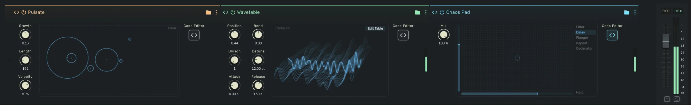

# Community Scripts

Community scripts are scripts shared by openDAW users: effects for Werkstatt, instruments for Apparat, MIDI effects
for Spielwerk and project scripts for the code editor. They live in a public GitHub repository,
[opendaw-commons](https://github.com/andremichelle/opendaw-commons). Anyone can add one, and once it is accepted it
shows up in every openDAW Studio, without a Studio update.



## Using community scripts

1. In Werkstatt, Apparat or Spielwerk, open the code editor and click **Community Scripts** in its toolbar.
2. In the code editor for project scripts, click **Community Scripts** in its top bar.
3. Search by name, author or tag, select a script to read its description and code, and click **Open**.

Every script links to its folder on GitHub, where you can read its history or suggest an improvement.

Community WebCLAP plugins have their own page, [Community WebCLAPs](/manuals/community-webclaps).

## Sharing your own script

You need a free [GitHub](https://github.com/) account. Everything below works in the browser, no command line and
no installed tools.

### 1. Finish the script in the Studio

Write and test your script in the Studio first. It is shared exactly as you wrote it, so make sure it compiles, sounds
the way you want and has sensible default values.

### 2. Choose a target and a folder name

The target is the device the script runs in:

1. `werkstatt` for audio effects
2. `apparat` for instruments
3. `spielwerk` for MIDI effects
4. `project` for project scripts

The folder name (the "slug") identifies your script for good. Use lowercase letters, digits and single hyphens, for
example `tape-saturation`. It must not be taken yet in that target, and it never changes after your script is
accepted. The name people see is separate and can be changed any time.

### 3. Prepare a folder with two files

On your computer, create a folder named like your slug, for example `tape-saturation`, with two files in it.

1. `script.js` with your script, copied from the Studio editor. Project scripts may be `script.ts` instead.
2. `meta.json` with what people read in the browser:

```json
{
  "name": "Tape Saturation",
  "description": "Warm tape style saturation with a drive and a tone control.",
  "author": {"name": "Your Name", "github": "your-github-name"},
  "tags": ["distortion", "warm"],
  "license": "CC0-1.0"
}
```

The name has at most 64 characters, the description at most 1000. Use up to 8 tags, lowercase words joined by
hyphens. `author.github` and `author.url` are optional.

### 4. Upload it and open the pull request

1. Open [opendaw-commons](https://github.com/andremichelle/opendaw-commons) and go to the folder of your target,
   for example `scripts/werkstatt`.
2. Click **Add file > Upload files**. GitHub asks you to fork the repository, which creates your own copy. Accept.
3. Drag your folder onto the page, so both files land in `scripts/werkstatt/tape-saturation/`.
4. Click **Propose changes**, then **Create pull request**, and describe your script in a sentence or two.

## What happens after you open a pull request

1. **The check runs.** It takes about a minute. It checks the folder name, `meta.json`, the size limits and that the
   script compiles in its device. Project scripts are type checked against the same API as the Studio editor.
2. **A comment appears** with what goes live, or a list of what has to be fixed. To fix something, edit the file in
   your branch on GitHub. The check runs again on every change.
3. **Anyone can try it before it is accepted.** Copy the link of your pull request, open **Community Scripts** in the
   matching device, paste the link into the field at the bottom and press **Load**. The script opens straight from
   your pull request, nothing is saved. Reviewers do the same.
4. **A maintainer reviews it.** Scripts run in other people's browsers, so every pull request is read by a person
   before it is accepted.
5. **It goes live.** After the merge it takes a minute or two until it is published. The Studio loads the list of
   community scripts once, so reload the Studio to see the new script.

## Changing a script

Improvements work the same way. Edit `script.js` or `meta.json` of an existing script in your fork, open a pull
request, and once it is merged everybody gets the new version. The folder name stays, so it remains the same script.

## Rules

1. Everything you share is released under [CC0](https://creativecommons.org/publicdomain/zero/1.0/): anyone may use
   it for anything, without credit. Only share code you wrote yourself or that is CC0 already.
2. A script is at most 256 KB.
3. Device scripts are plain JavaScript without imports. A project script may start with imports for your own editor,
   everything before its first comment line is dropped, exactly like the Studio does when you paste it.

## Let an AI open the pull request

An AI assistant that can use GitHub on your behalf, for example Claude Code with the GitHub command line tool
installed, can do all of the above. Fill in the first lines and paste the whole prompt:

```
Share my openDAW script in the community repository andremichelle/opendaw-commons.

Target: werkstatt (one of werkstatt, apparat, spielwerk, project)
Name: Tape Saturation
Description: Warm tape style saturation with a drive and a tone control.
Tags: distortion, warm
Author name: Your Name
GitHub user: your-github-name
Script: the file tape-saturation.js in this folder

Steps:
1. Read CONTRIBUTING.md in the repository and follow it.
2. Fork the repository with the GitHub command line tool and clone the fork.
3. Pick a slug from the name (lowercase letters, digits, single hyphens) that does not exist yet
   in scripts/<target>/.
4. Create scripts/<target>/<slug>/script.js with the script unchanged
   (script.ts for a TypeScript project script).
5. Create scripts/<target>/<slug>/meta.json with name, description, author, tags and
   "license": "CC0-1.0", as described in CONTRIBUTING.md.
6. Run the check locally: cd tools && npm ci && npm run validate. Fix every error it reports
   in my files, never change the tools or other items.
7. Commit on a new branch, push it to the fork and open a pull request against main.
8. Wait for the check, read its comment and fix what it reports.
9. Tell me the link of the pull request, so I can try it with the Load button in Community Scripts.
```
