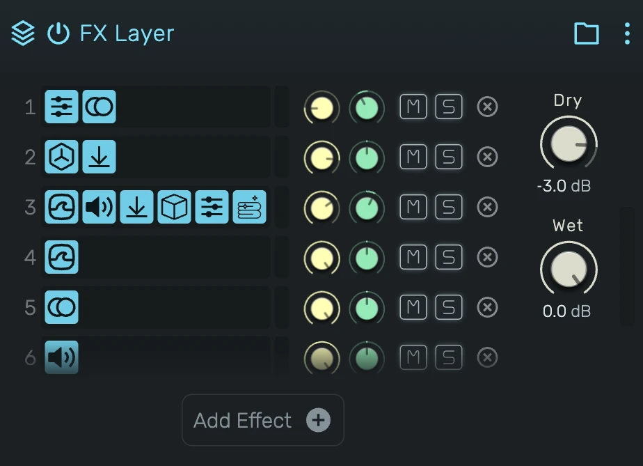

# FX Composite

Runs several effect chains in parallel and mixes them back together with a dry/wet control.

---

---

## 0. Overview

_FX Composite_ is a container that splits your signal into any number of parallel **layers**. The incoming signal is sent to every layer at once, each layer processes it through its own serial chain of effects, and their outputs are summed back into one wet signal. A dry/wet control blends that summed result against the untouched input.

Because the layers run side by side rather than one after another, you can process the same source several different ways and stack the results, without one effect feeding into the next.

Example uses:

- Parallel (New York) compression: one clean layer, one heavily compressed layer
- Layering several reverbs or delays on the same source
- Multi-tap or multi-character delays running at once

An **empty** FX Composite passes the signal through untouched, so dropping one into a chain never changes the sound until you add a layer.

---

## 1. Layers

Each row in the list is one parallel layer. A layer is a full serial effect chain: the devices inside it run one after another, and the layer as a whole runs in parallel with the others.

Every layer shows, from left to right:

- **Number** — its position in the list (1, 2, 3 …). Order is purely for your arrangement; since the layers sum in parallel, reordering them does not change the sound.
- **Device icons** — the effects currently in the layer, in chain order. An empty layer shows an empty slot.
- **Peak meter** — the layer's output level, after its own gain, pan and mute.
- **Channel controls** — gain, pan, mute and solo (see below).

Drag a layer by its icon area to reorder it.

---

## 2. Layer Controls

Each layer has its own small channel strip, matching a track header:

**Gain** — the layer's output level in decibels, applied before it enters the wet sum. Anchored at 0 dB.

**Pan** — places the layer in the stereo field, from hard left through centre to hard right.

**Mute (M)** — silences this layer's contribution to the wet sum. The other layers are untouched.

**Solo (S)** — plays only the soloed layer and silences every other layer, exactly like the mixer's solo. Solo more than one to hear several at once.

---

## 3. Add Effect

The **Add Effect** button below the list opens a menu of audio effects. Picking one creates a **new layer** holding just that effect.

You can also move existing effects into layers by drag and drop (see section 7).

---

## 4. Editing a Layer

Click a layer to enter it. The device panel then shows that layer's serial chain on its own, and the header shows the composite's name as a **back** button with an arrow. Add devices with the **+** buttons, remove, reorder and edit them inside the layer just like in any other effect chain, then click the back button to return to the composite.

---

## 5. Dry

Level of the original, unprocessed input signal, in decibels. Turn it down to −∞ for a fully wet result, or blend some in to keep the untouched source under the parallel layers.

By default Dry is off (−∞), so you hear only the layers.

---

## 6. Wet

Level of the summed layer outputs, in decibels. This is the combined result of every layer after its own gain, pan and mute.

By default Wet is at 0 dB.

Set Dry and Wet to taste for parallel-processing blends (for example, a low Wet under a full Dry for subtle parallel compression).

---

## 7. Drag & Drop

Existing effects can be dragged in and out of the composite:

- **An existing effect onto a layer** — moves that effect out of wherever it was and into the layer.
- **An effect onto the back button (inside a layer)** — moves the effect out of the layer and onto the parent chain, next to the composite.

To move an effect between two layers, move it out to the parent chain and then into the other layer.

---

## 8. Technical Notes

- The input is broadcast to every layer identically; layers never feed one another.
- Each layer's output passes through its own channel strip (gain, pan, mute) before it is summed; solo is resolved across all layers, like the mixer.
- The output is `dry · input + wet · Σ(layers)`. With Dry at −∞ and Wet at 0 dB (the default), the output is exactly the sum of the layers.