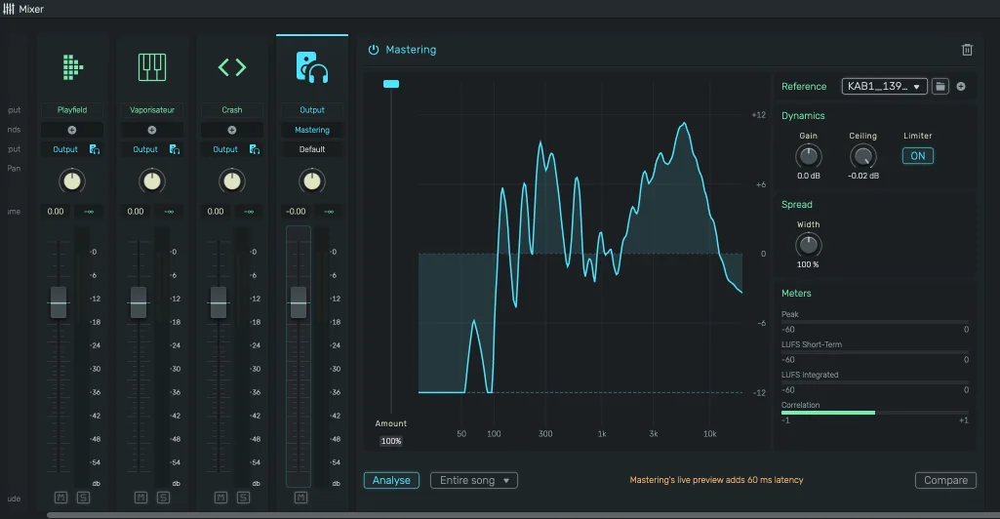

# Mastering

Masters the whole project to sound like a reference: its loudness, its frequency balance and its stereo width.

---

---

## 0. Overview

_Mastering_ lives on the output channel strip in the mixer. Click **Mastering** in the empty sends row of the output strip to open the panel next to it. It is based on [Matchering](https://github.com/sergree/matchering) by Sergree.

You choose a reference, click **Analyse**, and the project plays mastered from then on. The result is stored in the project, so it stays when you reopen it, and the full mixdown includes it. Stems are exported without it.

The text of the **Mastering** button is struck through when the project has a mastering that is switched off.

The trash icon in the panel header removes the mastering from the project (undo brings it back).

---

## 1. Reference

The reference is what your project should sound like.

- **Built-in profiles**: Balanced, Warm, Bright and Punchy. They work right away, no file needed.
- **From an audio file**: click the folder button or drop an audio file on the **Reference** section. Use a finished track you like in the same genre.

Only the analysis of the file is stored in the project, never the audio itself.

To use a file's analysis in other projects, click {icon:Add} next to it. It is saved as a user profile in this browser and appears in the list after the built-in profiles. With a saved profile selected, the same button deletes it. Again only the analysis is saved, not the audio.

Picking another reference matches again right away. As long as the project is unchanged, the mixdown is not rendered again, so this takes only a moment.

---

## 2. Analyse

Choose the part of the song in the bottom row (the entire song, the loop area or a section between markers) and click **Analyse**. The project is rendered and compared with the reference. Mastering analyses up to 10 minutes, the same limit applies to reference files.

The analysis stays until you analyse again. If you change your mix a lot, analyse again so the mastering follows it.

---

## 3. Display and Amount

The display shows the correction for the middle of the stereo image (solid line) and for the sides (dashed line), from 20 Hz to 20 kHz, within ±12 dB.

**Amount** (the vertical slider) blends between your mix (0 %) and the full correction (100 %).

---

## 4. Dynamics

- **Gain**: adds or removes level after the match (**-12 dB to +12 dB**)
- **Ceiling**: the highest level the limiter lets through (**-6 dB to 0 dB**)
- **Limiter**: switches the limiter on or off. Without it the output can exceed 0 dB.

---

## 5. Spread

**Width** narrows (below 100 %) or widens (above 100 %) the stereo image.

---

## 6. Meters

- **Peak**: the highest output level
- **LUFS Short-Term**: the loudness of the last three seconds
- **LUFS Integrated**: the loudness since playback started
- **Correlation**: +1 is mono, 0 is very wide, below 0 means parts cancel each other in mono

---

## 7. Compare

**Compare** plays your mix without mastering at the same loudness as the mastered version. A louder version always seems better, so this is the fair way to judge the mastering. Compare is never stored in the project.

The power switch in the panel header switches the mastering off for good (stored in the project).

---

## 8. Notes

- Mastering adds a delay of about 60 ms. Playback is compensated, but monitoring while recording is delayed, as the warning in the panel says. Switch the mastering off while you record.
- Projects opened with the openDAW SDK play without mastering.
- Mastering is licensed under the GPL-3.0 like Matchering and is not part of the commercial license.
