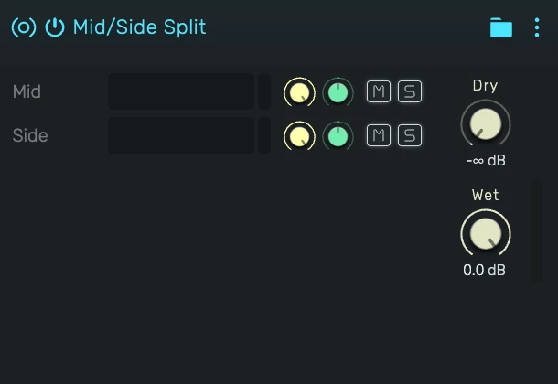

# Mid/Side Split

Processes the mid and the side of the signal through their own effect chains, then recombines them.

---

---

## 0. Overview

_Mid/Side Split_ separates the incoming stereo signal into its **mid** (what both channels share, the centre) and its **side** (what differs between them, the width). Each gets its own serial chain of effects, and the two are summed back into one stereo signal.

The branches are **fixed**: there are always exactly two, Mid and Side, and they cannot be added, removed or reordered. Each branch is otherwise a full effect chain you build and edit yourself.

Example uses:

1. Mid/side EQ: put a Revamp in each branch to shape the centre and the width separately
2. Cleaning up the low end: cut the lows in the Side branch so bass and kick stay mono
3. Widening: lift the highs in the Side branch, or add a reverb there only
4. Compressing the centre (vocal, kick, snare) without touching the stereo room

A Mid/Side Split with no effects in either branch recombines the signal, so an empty one is a transparent pass-through.

---

## 1. Branches (Mid and Side)

The list always holds two branches:

1. **Mid**: the sum of both channels, played on both channels.
2. **Side**: the difference of the channels, played in opposite phase on the right.

An effect with a spectrum display, like Revamp, shows only the mid inside the Mid branch and only the side inside the Side branch.

---

## 2. Branch Controls

Each branch has its own small channel strip, matching a track header:

**Gain**: the branch's output level in decibels, applied before it rejoins the sum. Turning Side up widens the image, turning it down narrows it.

**Pan**: places the branch in the stereo field.

**Mute (M)**: drops that branch from the output. Muting Side leaves the mono signal.

**Solo (S)**: plays only the soloed branch, so you hear the centre or the width on its own while you edit it.

---

## 3. Editing a Branch

Click the device icons of a branch to enter it. The device panel then shows that branch's chain on its own, with the composite's name as a **back** button in the header. Add, remove, reorder and edit devices inside the branch like any other effect chain, then click the back button to return.

---

## 4. Dry

Level of the original, unprocessed input signal, in decibels. By default Dry is off (−∞), so you hear only the two branches.

---

## 5. Wet

Level of the recombined branch outputs, in decibels. By default Wet is at 0 dB.

---

## 6. Drag & Drop

1. **An existing effect onto a branch**: moves that effect into the Mid or Side chain. A drop never creates a new branch.
2. **An effect onto the back button (inside a branch)**: moves the effect out of the branch and onto the parent chain, next to the composite.

---

## 7. Technical Notes

1. Mid is `(L + R) / 2` on both channels, Side is `(L − R) / 2` on the left and its inverse on the right. Their sum is the original left and right.
2. A soloed Mid plays the mono sum at its real level.
3. A stereo effect in one branch can reach the other. A reverb in Mid adds width, a stereo widener in Side can add centre. That is how the branches stay full stereo chains.
4. When an effect in one branch delays its signal (look-ahead), the other branch is delayed to match, so the two stay aligned.
5. An EQ that boosts or cuts strongly in only one branch shifts the phase there, which moves the stereo image slightly at those frequencies. Every mid/side EQ does this.
