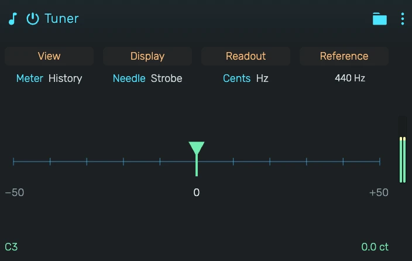

# Tuner

Measures the pitch of a single note and shows how far it is from the nearest note, as a needle, a strobe or a pitch history. The audio passes through unchanged.

---

---

## 0. Overview

_Tuner_ listens to a monophonic signal, a single string, voice or synth line, detects its pitch and shows the nearest note with the deviation in cents. It does not change the sound, so it can stay in the chain while you play.

Insert it on an instrument or on an audio track. For a microphone or a guitar input, enable input monitoring on the track so the signal reaches the device.

## 1. View

**Meter** shows the deviation from the nearest note on a scale from −50 to +50 cents, flat to the left and sharp to the right.

**History** shows the pitch of the last eight seconds as a trace over the note rows, with the note names on the right. The row of the detected note lights up.

## 2. Display

In Meter, **Needle** points a triangle at the deviation. **Strobe** moves stripes to the right when the note is sharp and to the left when it is flat. The stripes slow down as the note gets closer and stand still when it is in tune.

## 3. Range

In History, **Follow** keeps the played note in the middle of the rows. **Fixed** keeps the current rows in place.

Drag the display vertically to move the rows and horizontally to zoom in. A drag switches to Fixed and is one undo step. Escape cancels a drag. Double-click the display to follow the played note again.

## 4. Readout

The line below the display shows the note name and either the deviation in **Cents** or the detected frequency in **Hz**. Green means the note is within 5 cents, orange means it is further off.

When the note ends, the reading holds briefly, fades and stays dimmed until the next note. Bypass clears it.

## 5. Reference

The tuning frequency of A3, from 410 to 480 Hz, 440 Hz by default. Drag the value or double-click it to type a new one. openDAW names this note A3, as in its piano roll. Scientific pitch notation calls the same note A4.

## 6. Tips

- Play clean, sustained single notes. Chords, noise and strong overtones give unsteady readings.
- The detector covers about 30 to 2000 Hz and ignores signals below −55 dBFS. Low notes need a moment before a reading appears.
- Place Tuner before distortion and effects with modulation, so it hears the plain note.
- Settings are saved with the project. The history is not.

## Credits

Tuner was contributed by [polinom](https://github.com/polinom).
