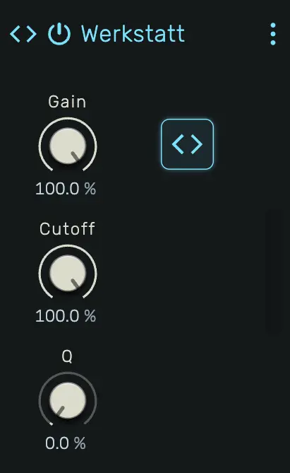

# Werkstatt

A programmable audio effect that lets you write custom DSP code in JavaScript. Define your own signal processing, declare parameters with knobs, and hot-reload changes in real time.

---



---

## 0. Overview

_Werkstatt_ is a scriptable audio effect device. You write a `Processor` class in JavaScript that receives stereo audio buffers and outputs processed audio sample by sample. Parameters declared in the code appear as automatable knobs on the device panel.

Example uses:

- Custom distortion or waveshaping
- Experimental stereo effects
- Granular or glitch processing
- Ring modulation
- Prototyping new effect ideas

---

## 1. Editor

Click the **Editor** button on the device panel to open the full-screen code editor. The editor uses Monaco (the engine behind VS Code) with JavaScript syntax highlighting.

The toolbar at the top provides:

- **Compile** — Compile and load the code into the audio engine
- **Community Scripts** — Browse and load processors shared by the community
- **From Clipboard** — Paste code from the clipboard into the editor and compile it in one step
- **Start AI-Prompt** — Copy a device-specific AI starter prompt to the clipboard, ready to paste into an AI assistant (e.g. ChatGPT, Claude) for help writing processors
- **Close Editor** — Return to the previous view

The status bar at the bottom shows the current state:

- **Idle** — No compilation attempted yet
- **Successfully compiled** — Code compiled and loaded into the audio engine
- **Error message** — Syntax error or runtime error details

---

## 2. Label

Set the device name using a `// @label` comment:

```javascript
// @label My Effect
```

When the script compiles, the device panel header will display this name. Omitting `@label` keeps the current name, unless that name came from the previous `@label`: then the device goes back to its default name. An empty `@label` (without a name) causes a compile error.

---

## 3. Parameters

Declare parameters using `// @param` comments at the top of your code:

```javascript
// @param gain 1.0
// @param cutoff 1000 20 20000 exp Hz
// @param mode 0 0 3 int
// @param bypass false
```

Each `@param` directive creates an automatable knob on the device panel. The full syntax is:

```
// @param <name> [default] [min max type [unit]]
```

### Simple (unipolar)

```
// @param gain           → 0–1, default 0
// @param gain 0.5       → 0–1, default 0.5
```

The knob value and `paramChanged` value are in the 0–1 range.

### Mapped

```
// @param cutoff 1000 20 20000 exp Hz    → exponential 20–20000, default 1000
// @param time 500 1 2000 linear ms      → linear 1–2000, default 500
// @param mode 0 0 3 int                 → integer 0–3, default 0
```

The knob displays the mapped value with the unit. `paramChanged` receives the mapped value directly — no manual scaling needed.

### Boolean

```
// @param bypass false         → Off/On, default Off
// @param bypass true          → Off/On, default On
// @param bypass bool          → Off/On, default Off
```

`paramChanged` receives `0` or `1`.

### Supported mapping types

| Type | Description | paramChanged receives |
|---|---|---|
| *(none)* | Unipolar 0–1 | `number` (0–1) |
| `linear` | Linear scaling between min and max | `number` (min–max) |
| `exp` | Exponential scaling (for frequency, time) | `number` (min–max) |
| `int` | Integer snapping between min and max | `number` (integer) |
| `bool` | On/Off toggle | `number` (0 or 1) |

Parameters are reconciled on each compile: new parameters are added, removed parameters are deleted, and existing parameters keep their current value. Multiple spaces between tokens are allowed for alignment.

### Groups

Organize parameters visually using `// @group` comments:

```javascript
// @group Envelope green
// @param attack  0.01  0.001  1.0  exp  s
// @param decay   0.2   0      2.0  exp  s
// @param sustain 0.7
// @param release 0.5   0      5.0  exp  s
// @group Filter blue
// @param cutoff  1000  20  20000  exp  Hz
// @param resonance 0.5
```

```
// @group <name> [color]
```

Parameters and samples declared after a `@group` belong to that group until the next `@group` or end of declarations. Each group renders as a labeled section on the device panel with a colored header.

Available colors: `blue`, `green`, `yellow`, `cream`, `orange`, `red`, `purple`, `white`, `gray`, `dark` (default).

Parameters before any `@group` appear ungrouped.

#### Prefix stripping

When a parameter's name starts with the group's name (case-insensitive) followed by an uppercase letter, the group prefix is stripped from the displayed control label. The full parameter name is still used for automation, MIDI learn, and tooltips.

```javascript
// @group Filter blue
// @param filterCutoff    1000  20  20000  exp  Hz   // shown as "Cutoff"
// @param filterResonance 0.5                        // shown as "Resonance"
```

If the next character is lowercase or the parameter name does not start with the group name, the label is shown unchanged.

### Sidechains

Declare any number of sidechain inputs, each with a unique name:

```javascript
// @sidechain Key
// @sidechain Modulator
```

Each `@sidechain` creates a source selector on the device panel. Click it to pick a track, a device or the input of an enclosing composite. Inside `process` the signal is available as `this.sidechains.<name>`, a `[left, right]` pair of `Float32Array` in the same block coordinates as the `src` and `out` buffers. An unconnected sidechain reads silence.

```javascript
const [keyL, keyR] = this.sidechains.Key
```

---

## 4. Latency

Some processors cannot answer a sample right away. An FFT needs a full window before it can transform it, and a look-ahead limiter looks at audio that has not been played yet. Both output their audio later than it came in, which shifts the track against the rest of the mix.

Declare that delay in milliseconds and the engine compensates for it:

```javascript
// @latency 21.3
```

The engine then delays every parallel path by the same amount, so the track stays in time with the rest of the mix. Automation and modulation on devices after Werkstatt follow the delayed audio, and mixdowns and stems start in time as well. The footer shows the total compensation as **PDC**.

- The value is in milliseconds and may have decimals. The engine converts it to frames at the project sample rate.
- Omitting `@latency` means no delay. A missing, negative or non-numeric value is a compile error.
- The engine compensates up to 100 ms per path.

If the delay changes while the script runs, for example when an FFT size parameter changes, set it in frames instead. A positive `this.latency` overrides the declaration:

```javascript
class Processor {
    constructor() {
        this.latency = 1024
    }
    paramChanged(label, value) {
        if (label === "size") {this.latency = 256 << Math.round(value * 4)}
    }
    process(io, block) {
        // ...
    }
}
```

The engine reads `this.latency` after every block, so a change takes effect immediately.

---

## 5. Keyboard Shortcuts

| Shortcut            | Action                              |
|---------------------|-------------------------------------|
| `Alt+Enter`         | Compile and run                     |
| `Ctrl+S` / `Cmd+S` | Compile, run, and save to project   |

---

## 6. Safety

The engine validates your output on every audio block:

- **NaN detection** — If any output sample is NaN, the processor is silenced and the error is reported.
- **Overflow protection** — If any sample exceeds ~60 dB (amplitude > 1000), the processor is silenced.
- **Runtime errors** — If `process()` throws an exception, the processor is silenced and the error is shown.

When silenced, the device outputs silence until the next successful compile.

---

## 7. API Reference

Your code must define a `class Processor` with a `process` method. Optionally implement `paramChanged` to receive parameter updates and `reset` to clear state on transport stop.

### Globals

| Variable     | Type     | Description                              |
|--------------|----------|------------------------------------------|
| `sampleRate` | `number` | Audio sample rate in Hz (e.g. 44100, 48000) |

### Processor class

```javascript
class Processor {
    process(io, block) {
        // io.src[0], io.src[1] — input Float32Arrays (left, right)
        // io.out[0], io.out[1] — output Float32Arrays (left, right)
        //
        // block.s0    — first sample index to process (inclusive)
        // block.s1    — last sample index to process (exclusive)
        // block.index — block counter (increments each audio callback)
        // block.bpm   — current project tempo in beats per minute
        // block.p0    — start position in ppqn (pulses per quarter note, 960 ppqn)
        // block.p1    — end position in ppqn
        // block.flags — bitmask:
        //   1 (transporting) — transport is active
        //   2 (discontinuous) — position jumped (seek, loop restart)
        //   4 (playing)       — playback is active
        //   8 (bpmChanged)    — tempo changed this block
    }
    paramChanged(label, value) {
        // label — string matching the @param name
        // value — number between 0.0 and 1.0
    }
    reset() {
        // optional, called when the transport stops: clear buffers and tails
    }
    // this.latency: optional, the output delay in frames (overrides // @latency, see Latency)
}
```

Pressing Stop silences the device. If your script has no `reset`, the Processor is rebuilt on stop and all state in class fields starts fresh.

---

## 8. Custom Views

A script can place its own editor element into the device panel, store custom data and show live telemetry.
Everything stays in the one script: the directive header, `class Processor` and the view classes.

```javascript
// @view 2 1 8 3                   class View at column 2, row 1, 8 columns wide, 3 rows high
// @window Editor 900 520          a resizable floating window for the class Editor
// @collection steps 16            16 records ...
// @field steps.velocity 0.8 0 1 linear
// @buffer wave 256                256 floats
// @stream spectrum 512 fft        processor -> view telemetry
```

| Directive | What it does |
|-----------|--------------|
| `@view [Class] <column> <row> <columns> <rows>` | Places a view into the 3-row panel grid, the knobs fill the free cells. Overlapping views are marked red. |
| `@window [Class] <width> <height>` | A floating window, opened from the device header or `host.openWindow()`. |
| `@collection` / `@field` / `@record` | Records the view edits and the processor reads (`this.data.<name>`). Saved with the project, undoable. |
| `@buffer <name> <length>` | Floats the view writes and the processor reads (`this.data.<name>`, a Float32Array). |
| `@stream <name> <length> [value\|ring\|fft]` | Live values from the processor to the view (`this.streams.<name>`). Never saved. |

Every view runs in its own sandboxed frame: it cannot reach the studio, the network or your files, and it shares
no variables with the Processor. A script with a view therefore keeps its top level free of state: only `class`,
`function` and `const` declarations, every top-level value is frozen. The code editor marks violations as you type.

In the view, the class receives `host`: `host.params`, `host.data`, `host.streams`, `host.edit` and
`host.gesture` (one undo step), `host.preview` (play notes), `host.send` (reaches `message(data)` of the
Processor) and `host.color` (the studio and display colours). Hover any of them in the code editor for details.

The mouse wheel over the view scrolls the device panel. A view that uses the wheel itself calls
`event.preventDefault()` in its wheel listener to keep it.

A parameter the view controls itself does not need a knob. Mark it with `[omit-default-ui]` and attach it to the
element that controls it, so a right click there opens the regular parameter menu (automation, modulation, MIDI
learn, reset):

```javascript
// @param cutoff 1000 20 20000 exp Hz [omit-default-ui]
```

```javascript
host.attachParameter(cutoffHandle, "cutoff", {enterValue: true})
```

`{enterValue: true}` adds a double click that opens the same text field as on a regular knob, to type a value
with its unit. Use it for knobs and sliders. Leave it out for checkboxes and buttons, where a double click
should only toggle.

The parameter stays automatable, modulatable and MIDI learnable. `host.params.cutoff.sources` tells the view
whether it is automated or modulated, `value` already includes both.

Community scripts with views exist for Apparat (Envelope Synth, Harmonic Synth, Wave Draw) and Spielwerk (Step Arp), the
API is the same here. The AI starter prompt describes all of it.

---

## 9. Community Scripts

Select **Community Scripts** in the code editor toolbar to browse processors shared by the openDAW community, for example Hard Clipper, Ring Modulator, Simple Delay and Biquad Lowpass. Search by name, author or tag, preview the code and click **Open** to load one into the device. Paste a GitHub link to a script, a folder or a pull request into the field at the bottom to load a script straight from GitHub, so you can try it before it is published. **How to contribute?** explains how to share your own.

---

## 10. AI Assistance

Click **Start AI-Prompt** in the editor toolbar to copy a detailed starter prompt to your clipboard. Paste it into any AI assistant to get help writing Werkstatt processors. Once the AI generates code, copy it and click **From Clipboard** to load and compile it directly.

The prompt also covers custom views and carries a design guide derived from the stock devices, so a view the AI writes
looks like part of openDAW.
