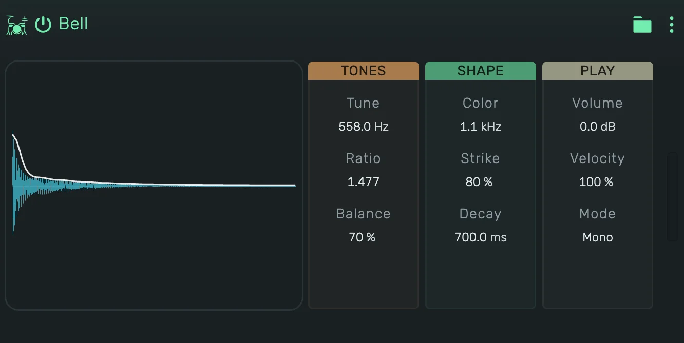

# openDrum Bell

Two pulse tones through a band-pass. The level falls in two stages: a fast strike, then a ring. It reaches cowbells,
agogos and tuned bells.

---

---

## 0. Overview

_openDrum Bell_ plays one hit per note. The display shows the hit the current values make, with its level over time.
Press the display to play the hit, in Gate it sounds as long as you hold it.

1. On a track, key 60 plays at Tune, every key above or below moves it by a semitone.
2. In a Playfield pad, the pad's Key sets the note: at 60, its default, every hit plays at Tune.
3. Every value can be automated.

Example uses:

1. A classic drum machine cowbell
2. An agogo pair on two pads with different Tune
3. A tuned bell melody on a track

---

## 1. Tones

1. **Tune**: the pitch of the lower tone.
2. **Ratio**: the pitch of the upper tone against the lower.
3. **Balance**: the level of the lower tone against the upper.

---

## 2. Shape

1. **Color**: the centre of the band-pass. A band on one of the tones is turned down so it never gets louder than the
   classic setting.
2. **Strike**: how much of the level is gone within the first 50 ms.
3. **Decay**: how long the rest rings.

---

## 3. Play

1. **Volume**: the level of the device.
2. **Pan**: the position of the hit between left and right.
3. **Velocity**: how much the note's velocity changes the level.
4. **Mode**:
    1. **Mono**: a new note cuts the ringing one.
    2. **Poly**: hits ring on and overlap.
    3. **Gate**: as Mono, and the hit is cut short when its note ends.
