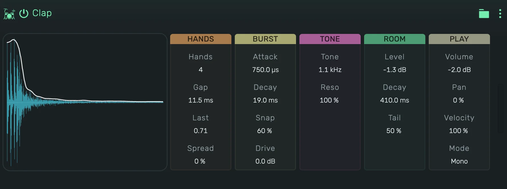

# openDrum Clap

A synthesized hand clap. A few hands clap one after another in quick succession, then the room rings on. It reaches the
classic electronic claps, tight snaps and big roomy claps.

---

---

## 0. Overview

_openDrum Clap_ plays one hit per note. The display shows the hit the current values make, with its level over time.
Press the display to play the hit, in Gate it sounds as long as you hold it.

1. On a track, key 60 plays at Tone, every key above or below moves Tone by a semitone.
2. In a Playfield pad, the pad's Key sets the note: at 60, its default, every hit plays at Tone.
3. Every value can be automated.

Example uses:

1. A classic drum machine clap
2. A tight snap on the backbeat
3. A big room clap with a long tail

---

## 1. Hands

1. **Hands**: how many hands clap, 1 to 8.
2. **Gap**: the time between two hands, up to 40 ms.
3. **Last**: the gap before the last hand against the others.
4. **Spread**: how much the hands differ in time, level and tone from hit to hit.

---

## 2. Burst

1. **Attack**: how fast each hand rises.
2. **Decay**: how long each hand lasts.
3. **Snap**: a bright crack on every hand.
4. **Drive**: saturation, up to 36 dB. It adds weight and grit, the level stays close to the clean hit.

---

## 3. Tone

1. **Tone**: the pitch of the band the clap sounds in.
2. **Reso**: how narrow and ringing that band is.

---

## 4. Room

1. **Level**: the level of the room after the last hand.
2. **Decay**: how long the room rings.
3. **Tail**: a longer, quieter part of the room under it.

---

## 5. Play

1. **Volume**: the level of the device.
2. **Velocity**: how much the note's velocity changes the level. Soft notes also bring fewer hands.
3. **Mode**:
    1. **Mono**: a new note cuts the ringing one.
    2. **Poly**: hits ring on and overlap.
    3. **Gate**: as Mono, and the hit is cut short when its note ends.
