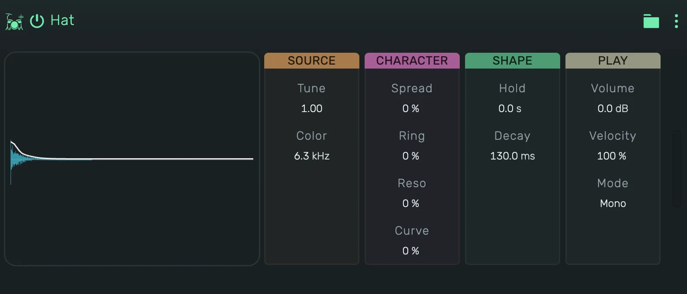

# openDrum Hat

Hi-hats from six square oscillators at inharmonic pitches, filtered bright. Hold and Decay go from a closed tick to a
long open hat. Every hit starts the oscillators somewhere else, so no two hits sound exactly the same.

---

---

## 0. Overview

_openDrum Hat_ plays one hit per note. The display shows the hit the current values make, with its level over time.
Press the display to play the hit, in Gate it sounds as long as you hold it.

1. On a track, key 60 plays at Tune, every key above or below moves it by a semitone.
2. In a Playfield pad, the pad's Key sets the note: at 60, its default, every hit plays at Tune.
3. Every value can be automated.

Example uses:

1. A closed and an open hat on two Playfield pads, both set to Exclusive, so the closed one chokes the open one
2. Ticking 16ths with a short Decay
3. A metallic ringing hat with Ring and Reso

---

## 1. Source

1. **Tune**: the pitch of all six oscillators, as a factor of the classic tuning.
2. **Color**: where the high-pass cuts in, from full to thin and bright.

---

## 2. Character

1. **Spread**: moves the oscillators apart or together, from a hollow to a clangy sound.
2. **Ring**: lets the oscillators modulate each other for a more metallic sound.
3. **Reso**: a peak at Color.
4. **Curve**: the shape of the fade, from a fast drop with a tail to a straight fall.

---

## 3. Shape

1. **Hold**: how long the hat stays at full level before it fades.
2. **Decay**: how long the fade takes.

---

## 4. Play

1. **Volume**: the level of the device.
2. **Velocity**: how much the note's velocity changes the level.
3. **Mode**:
    1. **Mono**: a new hit chokes the ringing one, like closing a hi-hat.
    2. **Poly**: hits ring on and overlap.
    3. **Gate**: as Mono, and the hit is cut short when its note ends.
