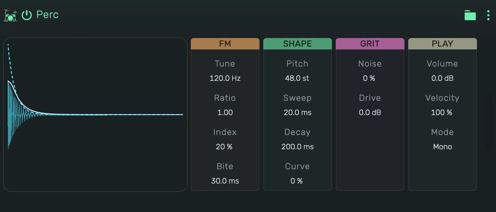

# openDrum Perc

A sine whose waveform is bent by a second sine (FM). The depth of the bend falls over Bite, the pitch falls (or rises)
over Sweep. It reaches zaps, lasers, blips, metallic and industrial hits.

---

---

## 0. Overview

_openDrum Perc_ plays one hit per note. The display shows the hit the current values make, with its level over time.
Press the display to play the hit, in Gate it sounds as long as you hold it.

1. On a track, key 60 plays at Tune, every key above or below moves it by a semitone.
2. In a Playfield pad, the pad's Key sets the note: at 60, its default, every hit plays at Tune.
3. Every value can be automated.

Example uses:

1. A zap with a long fall from four octaves up
2. A laser: a slow Sweep and a low Ratio
3. Glitches: Random modulators on Ratio, Index and Pitch

---

## 1. FM

1. **Tune**: the pitch the hit settles on.
2. **Ratio**: the pitch of the bending sine against Tune. Whole numbers sound tonal, others metallic.
3. **Index**: how strongly the second sine bends the first, from a pure tone to a harsh, bright one.
4. **Bite**: how fast that bend falls away.

---

## 2. Shape

1. **Pitch**: where the hit starts against Tune, from four octaves below to four above.
2. **Sweep**: how long the fall (or rise) back to Tune takes.
3. **Decay**: how long the hit lasts.
4. **Curve**: the shape of the decay, from a fast drop with a tail to a straight fall.

---

## 3. Grit

1. **Noise**: mixes in white noise.
2. **Drive**: saturation, up to 36 dB.

---

## 4. Play

1. **Volume**: the level of the device.
2. **Velocity**: how much the note's velocity changes the level and the Index.
3. **Mode**:
    1. **Mono**: a new note cuts the ringing one.
    2. **Poly**: hits ring on and overlap.
    3. **Gate**: as Mono, and the hit is cut short when its note ends.
