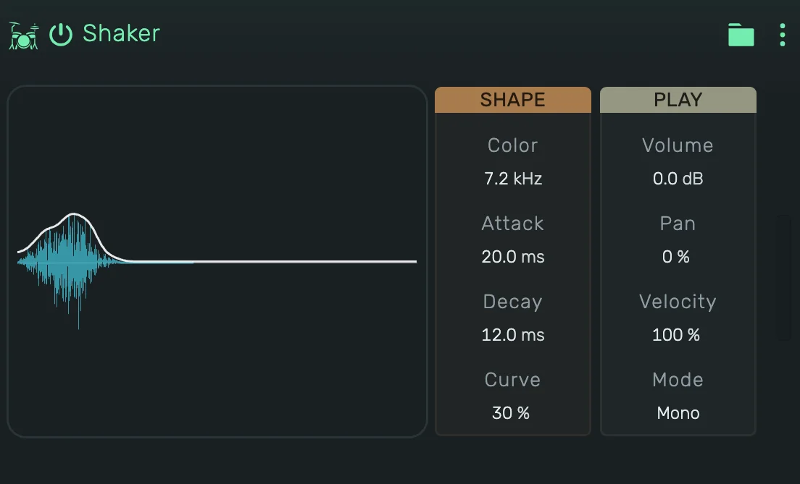

# openDrum Shaker

Filtered noise that swells in and fades: maracas, shakers and cabasas. Every hit has its own noise.

---

---

## 0. Overview

_openDrum Shaker_ plays one hit per note. The display shows the hit the current values make, with its level over time.
Press the display to play the hit, in Gate it sounds as long as you hold it.

1. The key does not change the sound, every note plays the same shaker.
2. In a Playfield pad, every hit plays the same.
3. Every value can be automated.

Example uses:

1. Classic drum machine maracas
2. A soft shaker on 16ths with a longer Attack
3. A short tick for hi-hat patterns

---

## 1. Shape

1. **Color**: where the high-pass cuts in, from full to thin and bright.
2. **Attack**: how long the hit swells in.
3. **Decay**: how long it fades.
4. **Curve**: the shape of the fade, from a fast drop with a tail to a straight fall.

---

## 2. Play

1. **Volume**: the level of the device.
2. **Pan**: the position of the hit between left and right.
3. **Velocity**: how much the note's velocity changes the level.
4. **Mode**:
    1. **Mono**: a new note cuts the ringing one.
    2. **Poly**: hits ring on and overlap.
    3. **Gate**: as Mono, and the hit is cut short when its note ends.
