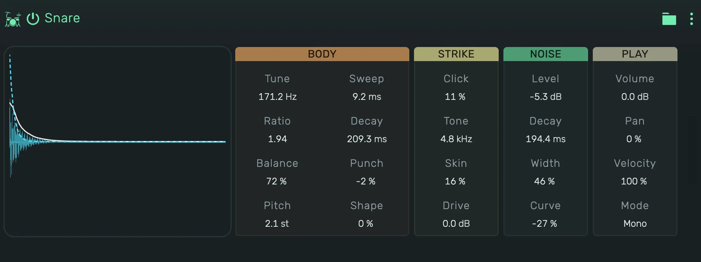

# openDrum Snare

A synthesized snare drum. Two tuned bodies give the drum its pitch, a band of noise the rattle of the wires. It reaches
tight electronic snares, fat snares with a long noise tail and rimmy, ringing snares.

---

---

## 0. Overview

_openDrum Snare_ plays one hit per note. The display shows the hit the current values make, with its level over time.
Press the display to play the hit, in Gate it sounds as long as you hold it.

1. On a track, key 60 plays at Tune, every key above or below moves it by a semitone.
2. In a Playfield pad, the pad's Key sets the note: at 60, its default, every hit plays at Tune.
3. Every value can be automated.

Example uses:

1. A classic electronic snare for hip hop and electro
2. A bright, noisy snare with a long tail for house
3. A pitched snare roll with Gate

---

## 1. Body

1. **Tune**: the pitch of the first body, 80 to 600 Hz.
2. **Ratio**: the pitch of the second body against the first.
3. **Balance**: the level of the second body against the first.
4. **Pitch**: how far above Tune the hit starts.
5. **Sweep**: how long the fall from Pitch to Tune takes.
6. **Decay**: how long the bodies ring.
7. **Punch**: the shape of the decay. Negative drops fast and lingers, positive holds and ends sooner.
8. **Shape**: the wave of the bodies, from a pure sine to a harder wave with more overtones.

---

## 2. Strike

1. **Click**: the level of the click at the start.
2. **Tone**: the brightness of the click.
3. **Skin**: the overtones of a drum skin that ring shortly after the hit.
4. **Drive**: saturation, up to 36 dB. It adds weight and grit, the level stays close to the clean hit.

---

## 3. Noise

1. **Level**: how loud the noise is.
2. **Decay**: how long the noise rings.
3. **Width**: how wide the band of noise is, from a narrow buzz to a broad hiss.
4. **Curve**: the shape of the noise's decay, like Punch for the bodies.

---

## 4. Play

1. **Volume**: the level of the device.
2. **Pan**: the position of the hit between left and right.
3. **Velocity**: how much the note's velocity changes the level.
4. **Mode**:
    1. **Mono**: a new note cuts the ringing one.
    2. **Poly**: hits ring on and overlap.
    3. **Gate**: as Mono, and the hit is cut short when its note ends.
