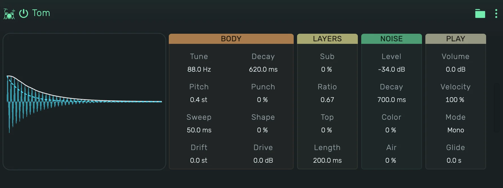

# openDrum Tom

Synthesized toms. A tuned body with a falling pitch, layers below and above it and a band of noise. It reaches deep
electronic toms, bright tight toms, sweeping disco toms, congas and bongos.

---

---

## 0. Overview

_openDrum Tom_ plays one hit per note. The display shows the hit the current values make, with its level over time.
Press the display to play the hit, in Gate it sounds as long as you hold it.

1. On a track, key 60 plays at Tune, every key above or below moves it by a semitone.
2. In a Playfield pad, the pad's Key sets the note: at 60, its default, every hit plays at Tune.
3. Every value can be automated.

Example uses:

1. A set of low, mid and high toms on a Playfield
2. Congas and bongos: Noise off, a short decay, a quick pitch kick
3. A disco tom with a long Sweep

---

## 1. Body

1. **Tune**: the pitch the body settles on, 40 to 800 Hz.
2. **Pitch**: how far above Tune the hit starts.
3. **Sweep**: how long the fall from Pitch to Tune takes.
4. **Drift**: a second, slow fall during the decay.
5. **Decay**: how long the body rings.
6. **Punch**: the shape of the decay. Negative drops fast and lingers, positive holds and ends sooner.
7. **Shape**: the wave of the body, from a pure sine to a harder wave with more overtones.
8. **Drive**: saturation, up to 36 dB. It adds weight and grit, the level stays close to the clean hit.

---

## 2. Layers

1. **Sub**: a second body below the first.
2. **Ratio**: the pitch of that second body against Tune.
3. **Top**: a short, rich body above the first.
4. **Length**: how long the top body rings.

---

## 3. Noise

1. **Level**: the level of the noise. At -48 dB there is none.
2. **Decay**: how long the noise rings.
3. **Color**: the noise from dark to bright.
4. **Air**: a high hiss above the noise.

---

## 4. Play

1. **Volume**: the level of the device.
2. **Velocity**: how much the note's velocity changes the level and how far the pitch falls.
3. **Mode**:
    1. **Mono**: a new note cuts the ringing one.
    2. **Poly**: hits ring on and overlap.
    3. **Gate**: as Mono, and the hit is cut short when its note ends.
4. **Glide**: in Mono and Gate, a new note slides from the sounding pitch.
