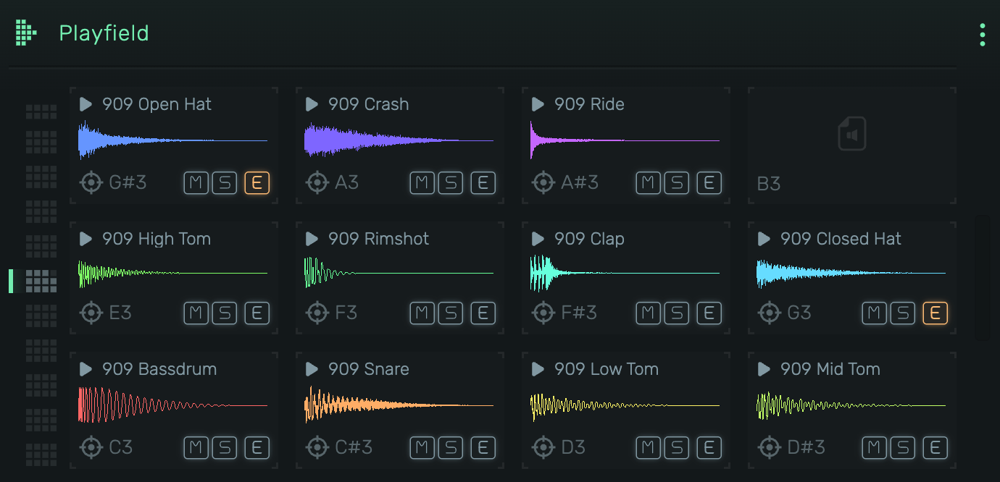
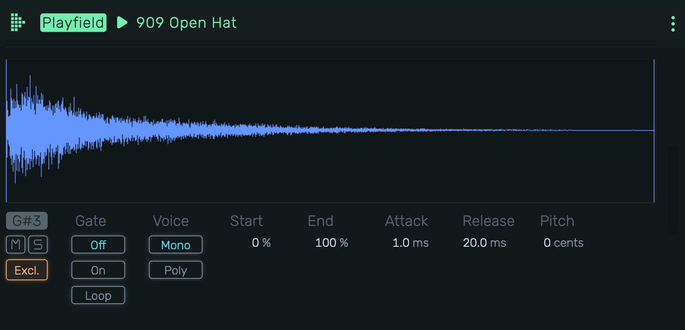

# Playfield

A sample-based drum machine and sampler with a grid of pads, each mapped to a MIDI note. Load samples, trigger them via MIDI or mouse, and shape each sound individually.

---

---

## 0. Overview

_Playfield_ organizes samples in a grid layout, with each pad assigned to a specific MIDI note. Drag samples onto pads, preview them with a click, and fine-tune each pad in its own device chain.

Example uses:

- Drum kits with per-sample control
- One-shot sound effects and stingers
- Chromatic sampling across multiple notes
- Layered percussion with exclusive groups

---

## 1. Grid View

The main interface showing all sample pads in a 4x3 grid (one octave).

### 1.1 Sample Pad

Each pad displays:

- **Header**: {icon:Play} icon and sample name (click to preview)
- **Waveform**: Visual representation of the sample with playback position
- **Note**: MIDI note assignment (e.g., C3, D#4)
- **M** (Mute): Silences the pad
- **S** (Solo): Solos the pad, muting all others
- **E** (Exclusive): Enables exclusive group mode. When active, triggering this pad stops other exclusive pads.
- {icon:Focus} Opens the pad. Highlighted orange when audio effects are applied.

### 1.2 Loading Samples

- **Drag & drop**: Drop audio files directly onto empty or occupied pads
- **Move samples**: Drag a sample from one pad to another to swap positions
- **Copy samples**: Hold ⌥ and drag a sample to copy it to another pad
- **Move to another octave**: Drag a sample over the octave dots on the left, hold until the octave switches, then drop on any pad
- **Context menu**: Right-click a pad to browse for samples
- **Delete**: Select a pad and press Delete to remove the sample

> **Note**: Copying uses ⌥ (Option/Alt) instead of ⌘ (Command) due to a long-standing browser limitation on macOS where the drop event doesn't fire when Command is held during drag operations.

### 1.3 Previewing

Click the header area ({icon:Play} + name) to trigger the pad. Release to stop (a one-shot plays on).

### 1.4 Octave Navigation

Use the octave selector to view different octave ranges. Each octave shows 12 pads (C through B).

---

## 2. Pad

Click the {icon:Focus} icon on any pad to open it. A pad holds its own MIDI effects, a [Nano](nano) that plays the sample, and its own audio effects, with gain, pan, mute and solo on top. The numbers above the chain jump between the pads.

---

---

### 2.1 How a pad plays

A pad only hears its own note and plays it at the Nano's root key, so the sample keeps its original pitch. A new pad starts like this:

- **Shot** on: the sample plays to the end of its region whatever the note length
- **Tail** on: the release rings on past the region end, so a chopped slice fades out naturally
- **Fixed** on: fine tuning of the incoming note (cents) is ignored
- **Mono**: a new hit fades the previous one out

Turn **Shot** off to stop the sample on note release, or turn the loop on to cycle the region while the note is held. Every other control works as described in the [Nano](nano) manual.

### 2.2 Move to Own Track

Right-click a pad and choose **Move to Own Track** to turn it into a regular instrument track next to the Playfield. Its instrument, effects, mix, automation and notes go along, so it sounds the same. The pad is removed from the Playfield.

### 2.3 Excl. (Exclusive Group)

When enabled on several pads, triggering any of them stops the others. Classic use: open and closed hi-hats.

### 2.4 Older projects

Projects saved before the pads open with every slot turned into a pad, with the same sample, region, envelope, pitch, mix, effects and automation.
