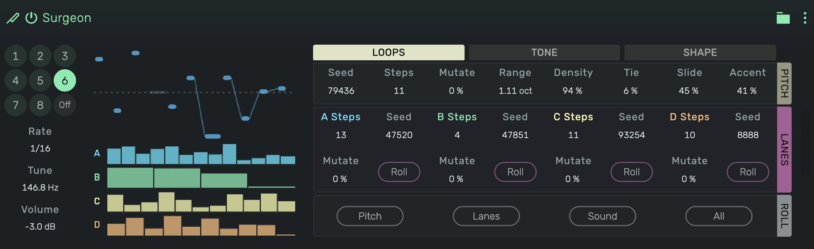

# Surgeon

An instrument for raw techno that plays by itself. It makes metallic, inharmonic FM themes from loops that come
from a seed, lets them drift over time and switches between eight stored patterns on the bar.

---

---

## 0. Overview

_Surgeon_ takes no notes from its track. While the transport plays, it plays its own loop:

1. A **pitch loop** makes the notes: pitches, rests, ties and slides.
2. Four **lanes** (A to D) run next to it. Each is a loop of values with its own length.
3. The **sound** has sixteen parameters. Each has its own value and one amount per lane, so a lane moves the
   sound from step to step.

Because the lanes have other lengths than the pitch loop, the same notes keep sounding different.

Nothing is quantised to a scale. Pitches are free, the centre is set in Hz.

Example uses:

1. Hypnotic metallic riffs that never repeat exactly
2. A theme behind a kick that changes character every few bars
3. Breaks: turn a lane amount on Ratio up by hand for a bar
4. Eight variations of one idea, fired live or drawn as automation

---

## 1. Patterns

The circles 1 to 8 are the patterns, **Off** silences the device.

1. Click a pattern while the transport plays and it takes over at the next bar. It flashes until then.
2. With the transport stopped it takes over at once.
3. The editor always shows the pattern you selected. Every edit is heard at once and is kept in that pattern.
4. Right click a pattern to copy or paste it.
5. The pattern is an automatable parameter. Right click a pattern or **Off** and choose **Create Automation** to
   draw pattern changes on the timeline.

Below the circles:

1. **Rate**: the step length of the pattern, an eighth, a sixteenth or a thirty-second.
2. **Tune**: the centre pitch in Hz.
3. **Volume**

---

## 2. Display

The top half shows the pitch loop of the current pass around the Tune line. A rest is a short dash, a tie is a
long note, a slide has a line from the previous pitch. Below it are the four lanes with their current values.
The white element in each loop is the step that plays right now.

---

## 3. Loops

### 3.1 Pitch

1. **Seed**: which loop. The same seed gives the same loop.
2. **Steps**: the loop length, 1 to 32.
3. **Mutate**: the chance per step and pass that a step is replaced by a new one. At 0 % the loop repeats
   unchanged.
4. **Range**: how far the pitches spread around Tune, in octaves.
5. **Density**: the share of steps that sound.
6. **Tie**: the share of notes that run into the next note, which then gets no new strike.
7. **Slide**: the chance that the pitch glides from the previous pitch over one step.
8. **Accent**: how far the velocities spread.

### 3.2 Lanes

Each lane has **Steps**, **Seed** and **Mutate** like the pitch loop, and a **Roll** button for a new seed.

### 3.3 Roll

1. **Pitch**: a new pitch loop.
2. **Lanes**: new values for all four lanes.
3. **Sound**: a new sound with a new mapping, the loops stay.
4. **All**: a whole new pattern. Mutate and Rate are never rolled.

Mutation follows the song position. Playing the same bars again gives the same changes.

---

## 4. Tone and Shape

Both tabs show a grid. The row **0** is the value of each parameter. The rows **A** to **D** say how much each
lane adds to it, from -100 % to 100 % of the parameter's range.

### 4.1 Tone

1. **Ratio 1**: the frequency of the first modulator against the note. Values that are not whole numbers sound
   metallic.
2. **Feedback**: from clean to noisy.
3. **Ratio 2** and **Depth 2**: a second modulator for more overtones. At a depth of zero it is off.
4. **Wave**: the wave of the oscillators, sine, half, rectified or burst.
5. **Depth**: the resting modulation depth.
6. **Strike**: extra depth at the start of every note.
7. **Strike Dec**: how fast that extra depth falls back.

### 4.2 Shape

1. **Fold** and **Fold Place**: a wave folder, before or after the gate.
2. **Length**: from a short hit to a long decay.
3. **Held**: the share of the longest notes that hold their whole step.
4. **Sine Gain** and **Sine Pitch**: a plain sine under the sound, at the pitch or an octave below.
5. **Glide**: how fast a tied note reaches its pitch.
6. **Velocity**: how much the velocity of a note changes its strike.

---

## 5. Automation

Every control can be automated. An automated control keeps following its automation whichever pattern plays.
