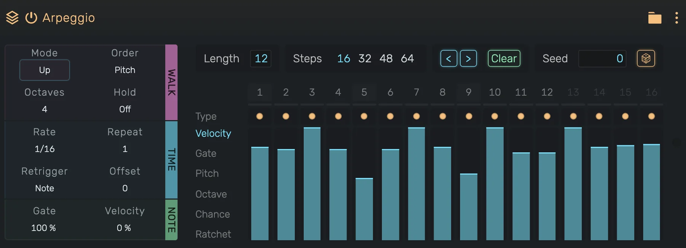

# Arpeggio

A tempo-synced arpeggiator that cycles through held notes in various patterns.

---

---

## 0. Overview

_Arpeggio_ transforms held chords into rhythmic note sequences. Hold any combination of notes and the arpeggiator plays them one at a time in the selected pattern, synced to the project tempo.

Example uses:

- Classic synth arpeggios
- Rhythmic chord breakups
- Sequenced bass lines from held notes
- Trance gates and rhythmic patterns

---

## 1. Walk

### Mode

How the arpeggiator walks through the held notes. Click the value for the list, or drag it. With C, E, G held:

| Mode | Plays | |
|------|-------|-|
| **Up** | C E G C E G | lowest to highest |
| **Down** | G E C G E C | highest to lowest |
| **UpDown** | C E G E C E | ping-pong, the turning notes play once |
| **DownUp** | G E C E G E | ping-pong starting at the top |
| **Up & Down** | C E G G E C | ping-pong, the turning notes play twice |
| **Down & Up** | G E C C E G | the same starting at the top |
| **Converge** | C G E C G E | outside in |
| **Diverge** | E G C E G C | inside out |
| **Con & Diverge** | C G E G C G | outside in, then back out |
| **Pinky Up** | C G E G C G | the top note between every other note |
| **Pinky UpDown** | C G E G C G | the same, the others going up and down |
| **Thumb Up** | C E C G C E | the bottom note between every other note |
| **Thumb UpDown** | C E C G C E | the same, the others going up and down |
| **Random** | | any note, repeats possible |
| **Random Other** | | any note, never the same twice in a row |
| **Shuffle** | | every note once per cycle, in a new order each cycle |
| **Random Once** | | one random order, repeated |
| **Walk** | | moves one note up (50%), stays (25%) or moves down (25%) |

All random modes follow the **Seed** (see Sequencer). The same seed always plays the same notes, also after a loop, a jump or in an export.

### Order

Which note counts as the first one.

- **Played**: Notes in the order they started. Notes of a chord that start together are ordered by pitch.
- **Pitch**: Notes from the lowest to the highest pitch.

### Octaves

Octave range extension. Range: **1 to 5**. The held notes repeat one octave higher for each extra octave, and the mode walks over all of them as one row.

### Hold

When on, the arpeggiator keeps playing the last notes after you let go of the keys. Keys pressed while others are still down are added. A key pressed after all keys were released starts a new set. Starting or stopping playback, a jump and a loop wrap clear the held notes.

---

## 2. Time

### Rate

Step rate as a tempo-synced fraction. Available values:

| Long | Medium | Short |
|------|--------|-------|
| 1/1 | 1/6 | 1/32 |
| 1/2 | 1/8 | 1/48 |
| 1/3 | 3/32 | 1/64 |
| 1/4 | 1/12 | 1/96 |
| 3/16 | 1/16 | 1/128 |
|  | 3/64 | |
|  | 1/24 | |

### Repeat

Note repetition count. Range: **1 to 16**.

How many times each note plays before the arpeggiator advances to the next note in the sequence:

- **1**: Each note plays once
- **2+**: Each note repeats before moving to the next

Useful for creating stuttering or rhythmic emphasis patterns.

### Retrigger

When the pattern starts again from its first step and first note.

- **Off**: Never. The pattern follows the song position, as in earlier versions.
- **Note**: When notes are played after a pause.
- **Bar**: At every bar, following the time signature.
- **Beat**: At every beat of the time signature, for example every eighth in 6/8.

### Offset

Starts the walk later by this many notes. Range: **0 to 15**.

---

## 3. Note

### Gate

Note length as a percentage of the step rate. Range: **0% to 200%**.

- **< 100%**: Staccato, notes are shorter than the step
- **100%**: Notes fill exactly one step (legato)
- **> 100%**: Notes overlap into the next step

### Velocity

Velocity scaling. Range: **-100% to +100%**.

Controls how the output velocity relates to the input note velocities:

- **-100%**: All notes play at velocity 0, ignoring input
- **-100% to 0%**: All notes play at the same fixed velocity, rising from 0 to full, ignoring input
- **0%**: All notes play at full velocity, ignoring input
- **0% to +100%**: Blend from full velocity toward the original input velocity
- **+100%**: Notes retain their original input velocity

---

## 4. Sequencer

A 64-step sequencer shapes every step of the arpeggio. **Length** sets how many steps play (1 to 64). **Steps** switches the visible page of 16 steps. The blue bar above the steps shows the playing step.

### Type

Click a step to cycle its type:

- **Note** (dot): plays the next note of the walk.
- **Rest** (dim dot): plays nothing.
- **Tie** (line): plays nothing new, the previous note lasts through this step.
- **Chord** (stack): plays every held note at once.

Every step moves the walk on by one note, rests and ties included, so a melody stays in place when you add rests. Rest and tie steps have no values, their lanes are dimmed.

### Lanes

Pick a lane on the left and drag the bars to edit it:

- **Velocity**: 0% to 100%, scales the velocity set above.
- **Gate**: 0% to 200%, multiplies the gate set above. The line marks 100%.
- **Pitch**: -12 to +12 semitones.
- **Octave**: -2 to +2 octaves.
- **Chance**: 0% to 100%, how likely the step plays. Follows the Seed.
- **Ratchet**: 1 to 7 equal hits within the step.

### Tools

- **< >**: Shift all steps one step left or right within the length.
- **Clear**: Reset every step to a plain note and every lane to its default.
- **Seed** and the dice: the seed of all random decisions. Type a number or roll a new one.

---

## 5. Technical Notes

- Arpeggio pattern syncs to transport position (unless Retrigger is set)
- Random modes and Chance depend only on the seed and the step position, never on what played before
- Every played note keeps the fine tuning (cents) of the held note it comes from
- A played note lasts its full gate length, even when the held key is released during the step
- UpDown mode sequence length: `(notes × octaves × 2) - 2` to avoid repeating endpoints
- Projects made with earlier versions play as before. Mode automation and modulation are converted to the new list of modes
