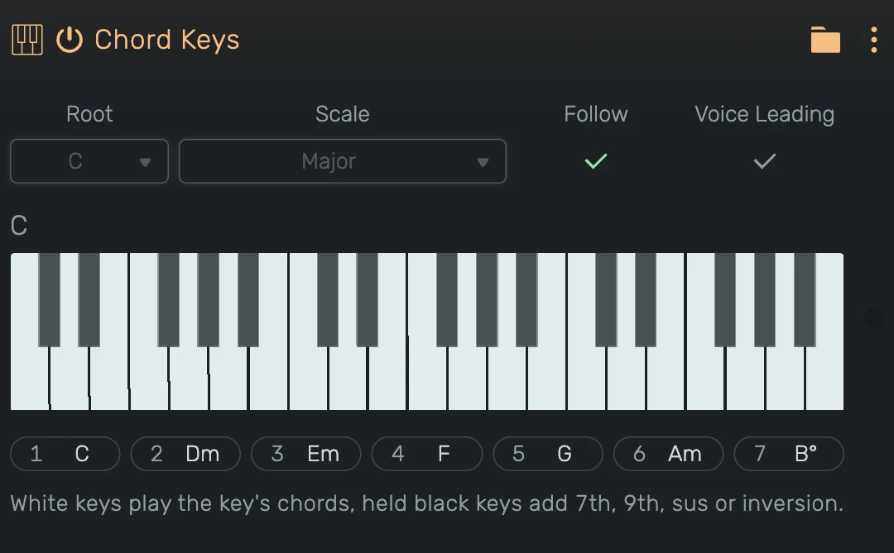
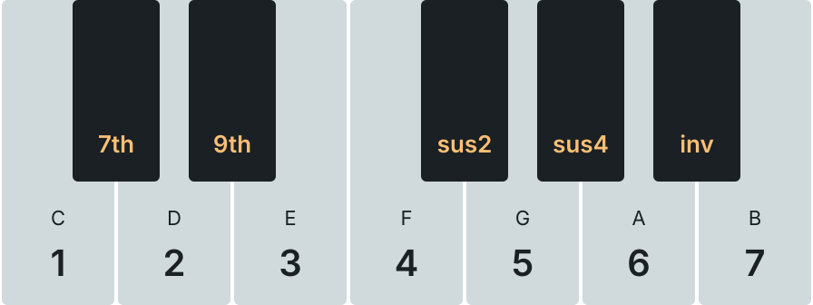

# Chord Keys

A MIDI effect that plays the chords of a key from single keys.

---

---

## 0. Overview

_Chord Keys_ turns every white key into a chord. C plays the chord on step 1 of the key, D the chord on step 2 and so on up to B on step 7, whatever the root of the key is. In C major that is C, Dm, Em, F, G, Am and Bdim. The next octave plays the same chords one octave higher, and the chords climb from the root of the key, so they always rise from C to B.

Hold a black key together with a white key to change the chord:

- **C#** adds the 7th
- **D#** adds the 9th, together with **C#** you get the 7th and the 9th
- **F#** plays the chord as sus2
- **G#** plays the chord as sus4
- **A#** plays the next inversion

A black key can be pressed before or after the white key. Pressed while the chord sounds, only the notes that change are sent: the added 7th starts on its own and the rest of the chord keeps sounding. Releasing the black key ends only that note. A black key alone plays nothing.

When several white keys are held, the last one pressed plays. Releasing it goes back to the one still held.

The display shows the name of the chord above the notes that sound, and below the seven chords of the key, the one that sounds is lit.

Example uses:

- Playing chord progressions with one finger
- Sketching harmonies before writing the notes
- Following the key changes of a song with **Follow**

---

## 1. Parameters

- **Root**: The root key, **C to B**.
- **Scale**: The scale, for example Major, Natural Minor or Dorian. Pentatonic and blues scales play the chords of their parent scale.
- **Follow**: Uses the key of the project's key track at the note's position instead of Root and Scale. Without key track events it uses the project key set in the header. Root and Scale are disabled while it is on.
- **Voice Leading**: Plays each chord in the inversion closest to the previous one, so the notes move as little as possible between chords. Holding **A#** overrides it and plays the next inversion.

---

## 2. Technical Notes

- All parameters are automatable
- A chord takes the velocity of its white key
- Chord notes carry the remaining length of their white key, so MIDI effects after Chord Keys, like Arpeggio, see them
- Every chord note ends with its own note-off, also when the key changes while it sounds
- Disabling or removing the device ends every note it started
