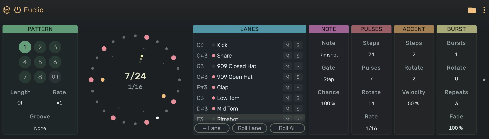

# Euclid

A MIDI effect that plays notes on Euclidean rhythms, one lane per note, made for the Playfield.

---

---

## 0. Overview

_Euclid_ plays while the transport runs. Every lane plays one note, so on a Playfield every lane plays one pad. A
Euclidean rhythm spreads a number of hits as evenly as possible over a number of steps: 3 hits on 8 steps give the
tresillo, 4 on 16 a four on the floor. Notes that arrive from the track pass through unchanged.

The circle shows the selected lane. The outer ring holds its steps, the middle ring its accents and the inner ring its
bursts. While the transport runs, the step that plays is lit.

1. The lane list shows each lane's note and, on a Playfield, the name of its pad. The dot lights while the lane's note
   sounds. Drag a lane up or down to reorder the list, right click a lane to remove it. **M** mutes a lane, **S**
   plays only the soloed lanes.
2. **+ Lane** adds a lane on the next note without one, up to 127 lanes.
3. **Roll Lane** and **Roll All** throw a new rhythm for the selected lane or for every lane of the pattern. The rate and
   the bursts stay as they are.
4. Two lanes on the same note that hit at the same moment play one note, the louder one.

Example uses:

1. A drum pattern on a Playfield, every pad its own Euclidean rhythm
2. Polyrhythms: lanes of different lengths that meet again only after many bars
3. Rolls and flams on a hat with bursts

---

## 1. Pattern

Eight patterns, each holds the rhythm of every lane. The lanes' notes, velocities and gates are the same in every
pattern.

1. **1 to 8**: plays that pattern from the next bar. A tile flashes until its bar. **Off** stops the lanes at the next
   bar, notes from the track still pass. The pattern can be automated.
2. Click a tile and press Cmd+C or Cmd+V to copy or paste its pattern, the context menu has **Copy pattern**,
   **Paste pattern** and **Export to Note Region**, which writes the pattern into a region at the playhead.
3. **Length**: restarts every lane after this many steps of 1/16. **Off** lets every lane cycle on its own.
4. **Rate**: plays every lane ÷4, ÷2, ×1, ×2 or ×4 as fast.
5. **Groove**: the groove of the pattern, from the project's grooves.

---

## 2. Note

1. **Note**: the note the lane plays, with the pad names of a Playfield.
2. **Gate**: **Step** plays a note for one step, **Next hit** holds it until the lane's next hit.
3. **Chance**: the probability that a hit plays. The same hits play on every pass.

---

## 3. Pulses

1. **Steps**: the length of the lane's cycle, 1 to 32.
2. **Pulses**: how many hits are spread over the steps.
3. **Rotate**: shifts the hits to the right.
4. **Rate**: the note value of a step, from 1/4 to 1/32, straight, triplet (T) or dotted (.).

---

## 4. Accent

1. **Steps**: how many of the lane's hits are accented, spread over the hits the way the hits spread over the steps.
2. **Rotate**: shifts the accents over the hits.
3. **Velocity**: the level of a hit without accent. Accented hits play at full velocity, so a lower velocity makes the
   accents stand out.

---

## 5. Burst

1. **Bursts**: how many hits play as a burst, spread over the hits.
2. **Rotate**: shifts the bursts over the hits.
3. **Repeats**: how many evenly spaced triggers a burst plays within its step, 2 to 8.
4. **Fade**: how the triggers fall in level. At 0 they all play at the hit's level, below 0 they rise towards the last.
