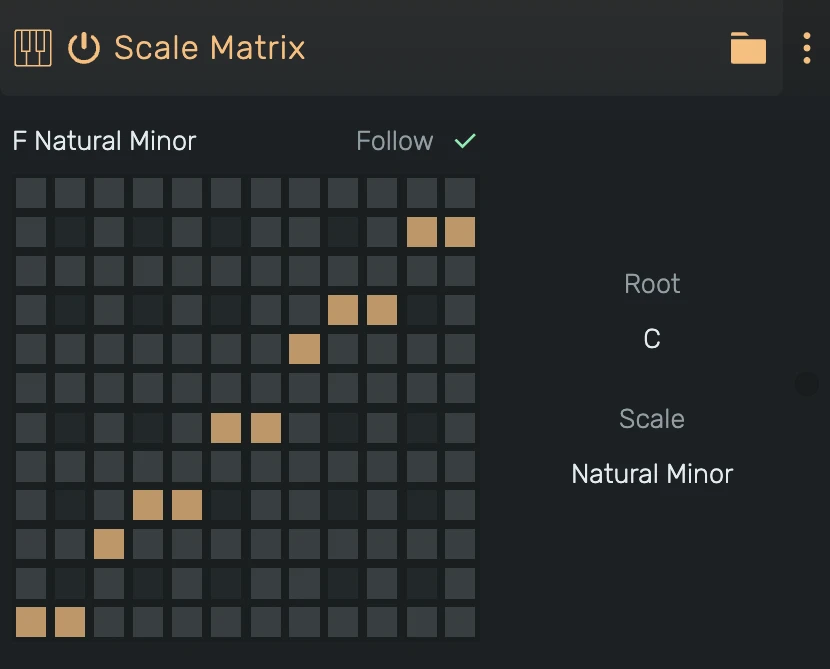

# Scale Matrix

A MIDI effect that moves every incoming note onto the nearest key of a scale.

---

---

## 0. Overview

_Scale Matrix_ makes sure every note you play or program lands in key. A note that is part of the scale passes unchanged. Any other note moves to the closest key of the scale. When a note sits exactly between two keys, it moves down.

The grid shows the result: each column is an incoming note, the lit cell in it is the note that comes out. The grid starts at the root in the bottom left corner and walks up in semitones.

Click a cell to build your own mapping. The scale switches to **Custom**, starting from the scale you had. Clicking a cell sends that column's note to the clicked key. Clicking the lit cell of a column mutes that note.

Example uses:

- Playing in key without hitting a wrong note
- Keeping random or generated melodies in key
- Following the key changes of a song with **Follow**

---

## 1. Parameters

- **Root**: The root key of the scale, **C to B**.
- **Scale**: The scale, for example Major, Natural Minor or Dorian, or **Custom** for your own mapping. A custom mapping is relative to the root, changing Root moves it.
- **Follow**: Uses the key of the project's key track at the note's position instead of Root and Scale. Without key track events it uses the project key set in the header. With Custom only the root of the project key is used.

---

## 2. Technical Notes

- All parameters are automatable
- Velocity and fine pitch are preserved
- A note ends on the key it started with, even if the parameters change while it sounds
- Two notes that land on the same key share it, the key ends when the last of them is released
