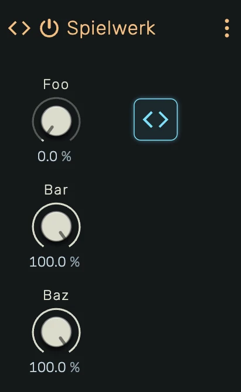

# Spielwerk

A programmable MIDI effect that lets you write custom note transformations in JavaScript. Filter, reshape, generate, or delay notes — declare parameters with knobs and hot-reload changes in real time.

---



---

## 0. Overview

_Spielwerk_ is a scriptable MIDI effect device. You write a `Processor` class in JavaScript that receives incoming events and yields transformed or new notes. Parameters declared in the code appear as automatable knobs on the device panel.

Example uses:

- Custom velocity curves and mapping
- Pitch transposition and micro-tuning
- Chord generators
- Arpeggiators and step sequencers
- Probability-based note filtering
- Note echo and delay
- Humanization and timing randomization

---

## 1. Editor

Click the **Editor** button on the device panel to open the full-screen code editor. The editor uses Monaco (the engine behind VS Code) with JavaScript syntax highlighting.

The toolbar at the top provides:

- **Compile** — Compile and load the code into the engine
- **Community Scripts** — Browse and load processors shared by the community
- **From Clipboard** — Paste code from the clipboard into the editor and compile it in one step
- **Start AI-Prompt** — Copy a device-specific AI starter prompt to the clipboard, ready to paste into an AI assistant (e.g. ChatGPT, Claude) for help writing processors
- **Close Editor** — Return to the previous view

The status bar at the bottom shows the current state:

- **Idle** — No compilation attempted yet
- **Successfully compiled** — Code compiled and loaded into the engine
- **Error message** — Syntax error, runtime error, or validation failure

---

## 2. Label

Set the device name using a `// @label` comment:

```javascript
// @label My MIDI Effect
```

When the script compiles, the device panel header will display this name. Omitting `@label` keeps the current name, unless that name came from the previous `@label`: then the device goes back to its default name. An empty `@label` (without a name) causes a compile error.

---

## 3. Parameters

Declare parameters using `// @param` comments at the top of your code:

```javascript
// @param chance 0.5 0 1 linear
// @param repeats 3 1 8 int
// @param mode 0 0 3 int
// @param bypass false
```

Each `@param` directive creates an automatable knob on the device panel. The full syntax is:

```
// @param <name> [default] [min max type [unit]]
```

### Simple (unipolar)

```
// @param amount           → 0–1, default 0
// @param amount 0.5       → 0–1, default 0.5
```

The knob value and `paramChanged` value are in the 0–1 range.

### Mapped

```
// @param delay 120 24 480 int          → integer 24–480, default 120
// @param chance 0.5 0 1 linear         → linear 0–1, default 0.5
// @param decay 0.7 0.1 1.0 linear      → linear 0.1–1.0, default 0.7
```

The knob displays the mapped value with the unit. `paramChanged` receives the mapped value directly — no manual scaling needed.

### Boolean

```
// @param bypass false         → Off/On, default Off
// @param bypass true          → Off/On, default On
// @param bypass bool          → Off/On, default Off
```

`paramChanged` receives `0` or `1`.

### Supported mapping types

| Type | Description | paramChanged receives |
|---|---|---|
| *(none)* | Unipolar 0–1 | `number` (0–1) |
| `linear` | Linear scaling between min and max | `number` (min–max) |
| `exp` | Exponential scaling (for frequency, time) | `number` (min–max) |
| `int` | Integer snapping between min and max | `number` (integer) |
| `bool` | On/Off toggle | `number` (0 or 1) |

Parameters are reconciled on each compile: new parameters are added, removed parameters are deleted, and existing parameters keep their current value. Multiple spaces between tokens are allowed for alignment.

### Groups

Organize parameters visually using `// @group` comments:

```javascript
// @group Timing green
// @param rate    0.5   0.1  2.0  exp
// @param swing   0.5
// @group Output blue
// @param chance  0.5   0    1    linear
// @param repeats 3     1    8    int
```

```
// @group <name> [color]
```

Parameters declared after a `@group` belong to that group until the next `@group` or end of declarations. Each group renders as a labeled section on the device panel with a colored header.

Available colors: `blue`, `green`, `yellow`, `cream`, `orange`, `red`, `purple`, `white`, `gray`, `dark` (default).

Parameters before any `@group` appear ungrouped.

#### Prefix stripping

When a parameter's name starts with the group's name (case-insensitive) followed by an uppercase letter, the group prefix is stripped from the displayed control label. The full parameter name is still used for automation, MIDI learn, and tooltips.

```javascript
// @group Timing green
// @param timingRate    0.5  0.1  2.0  exp     // shown as "Rate"
// @param timingSwing   0.5                    // shown as "Swing"
```

If the next character is lowercase or the parameter name does not start with the group name, the label is shown unchanged.

---

## 4. Note Flow

By default _Spielwerk_ **passes every incoming note through unchanged**, and the notes your generator yields are **added on top**. A device with no script, an empty `process`, or a script that failed to compile is therefore transparent: it never swallows the notes of the track it sits on.

Declare `// @no-pass` to suppress the incoming notes, so the device emits **only** what you yield:

```javascript
// @no-pass
```

Which one you want follows from what the processor does:

| Processor | Directive |
|---|---|
| Transform (velocity, pitch, timing) | `// @no-pass`, otherwise the original note sounds alongside your version |
| Filter (probability gate, range filter) | `// @no-pass`, otherwise the rejected notes still pass |
| Replace (sequencer, arpeggiator) | `// @no-pass` |
| Add (harmonizer, echo tail, ghost notes) | no directive, the original is kept for you |

Most bundled examples declare `// @no-pass`, since they replace the incoming notes. The two that do not are worth reading: _303 Sequencer_ layers its pattern on top of whatever arrives, and _Echo / Note Delay_ yields only the repeats and lets the dry note pass.

Passed-through notes keep their identity: position, duration, pitch, velocity, cent and their note-off arrive downstream exactly as they came in.

---

## 5. Keyboard Shortcuts

| Shortcut            | Action                              |
|---------------------|-------------------------------------|
| `Alt+Enter`         | Compile and run                     |
| `Ctrl+S` / `Cmd+S` | Compile, run, and save to project   |

---

## 6. Safety

The engine validates every note your code yields:

- **Pitch range** — Must be 0–127. Out-of-range values silence the processor.
- **Velocity range** — Must be 0.0–1.0. Out-of-range values silence the processor.
- **Duration** — Must be positive. Zero or negative durations silence the processor.
- **Position** — Must not be in the past (before block start). Past positions silence the processor.
- **NaN detection** — If any note property is NaN, the processor is silenced.
- **Note flood** — Maximum 128 notes per block. Exceeding this silences the processor.
- **Scheduler overflow** — Maximum 128 future-scheduled notes. Exceeding this silences the processor.
- **Runtime errors** — If `process()` throws, the processor is silenced.

When silenced, all notes the processor generated are released. The incoming notes keep flowing through the device until the next successful compile, so a broken script never mutes the track. A processor that declared `// @no-pass` stays silent instead, since suppressing the input is what its author asked for.

---

## 7. API Reference

Your code must define a `class Processor` with a generator method `process`. Optionally implement `paramChanged` to receive parameter updates and `reset` to clear state on transport jumps.

### Processor class

```javascript
// @no-pass

class Processor {
    * process(block, events) {
        for (const event of events) {
            if (event.gate) {
                yield event
            }
        }
    }
    paramChanged(label, value) {
    }
    reset() {
    }
}
```

Without the `// @no-pass` line this example would emit each note twice: once forwarded, once yielded. See section 4.

### Block properties

| Property | Type     | Description                                           |
|----------|----------|-------------------------------------------------------|
| `from`   | `number` | Start position in ppqn (inclusive)                     |
| `to`     | `number` | End position in ppqn (exclusive)                      |
| `bpm`    | `number` | Current project tempo in BPM                          |
| `flags`  | `number` | Bitmask: 1 = transporting, 2 = discontinuous (jumped) |

### Event types

The `events` parameter is a unified iterator containing both note-ons and note-offs in chronological order.

**Note-on event** (`gate: true`):

| Property   | Type      | Range   | Description                           |
|------------|-----------|---------|---------------------------------------|
| `gate`     | `boolean` | `true`  | Identifies this as a note-on          |
| `id`       | `number`  | —       | Unique identifier for this note       |
| `position` | `number`  | ppqn    | Start position (960 ppqn per quarter) |
| `duration` | `number`  | ppqn    | Note length                           |
| `pitch`    | `number`  | 0–127   | MIDI note number                      |
| `velocity` | `number`  | 0.0–1.0 | Note velocity                         |
| `cent`     | `number`  | any     | Fine pitch offset in cents            |

**Note-off event** (`gate: false`):

| Property   | Type      | Range   | Description                           |
|------------|-----------|---------|---------------------------------------|
| `gate`     | `boolean` | `false` | Identifies this as a note-off         |
| `id`       | `number`  | —       | Matches the id of the original note-on|
| `position` | `number`  | ppqn    | Position of the note-off              |
| `pitch`    | `number`  | 0–127   | MIDI note number                      |

### Yielded notes

Your generator yields note-on objects only: `{ position, duration, pitch, velocity, cent }`

| Property   | Type     | Range     | Description                           |
|------------|----------|-----------|---------------------------------------|
| `position` | `number` | ppqn      | Start position (960 ppqn per quarter) |
| `duration` | `number` | ppqn      | Note length                           |
| `pitch`    | `number` | 0–127     | MIDI note number                      |
| `velocity` | `number` | 0.0–1.0   | Note velocity                         |
| `cent`     | `number` | any       | Fine pitch offset in cents            |

### Future scheduling

Notes with `position >= block.to` are not emitted immediately. They are held in an internal scheduler and emitted automatically when the transport reaches their position in a later block. This enables effects like echo/delay and humanizers that shift notes across block boundaries.

### State across blocks

Your processor instance persists across blocks. Use class fields to track state:

```javascript
class Processor {
    held = []
    counter = 0
    * process(block, events) { ... }
}
```

State is reset when the code is recompiled (a new instance is created).

---

## 8. Custom Views

A script can place its own editor element into the device panel, store custom data and show live telemetry.
Everything stays in the one script: the directive header, `class Processor` and the view classes.

```javascript
// @view 2 1 8 3                   class View at column 2, row 1, 8 columns wide, 3 rows high
// @window Editor 900 520          a resizable floating window for the class Editor
// @collection steps 16            16 records ...
// @field steps.velocity 0.8 0 1 linear
// @buffer wave 256                256 floats
// @stream spectrum 512 fft        processor -> view telemetry
```

| Directive | What it does |
|-----------|--------------|
| `@view [Class] <column> <row> <columns> <rows>` | Places a view into the 3-row panel grid, the knobs fill the free cells. Overlapping views are marked red. |
| `@window [Class] <width> <height>` | A floating window, opened from the device header or `host.openWindow()`. |
| `@collection` / `@field` / `@record` | Records the view edits and the processor reads (`this.data.<name>`). Saved with the project, undoable. |
| `@buffer <name> <length>` | Floats the view writes and the processor reads (`this.data.<name>`, a Float32Array). |
| `@stream <name> <length> [value\|ring\|fft]` | Live values from the processor to the view (`this.streams.<name>`). Never saved. |

Every view runs in its own sandboxed frame: it cannot reach the studio, the network or your files, and it shares
no variables with the Processor. A script with a view therefore keeps its top level free of state: only `class`,
`function` and `const` declarations, every top-level value is frozen. The code editor marks violations as you type.

In the view, the class receives `host`: `host.params`, `host.data`, `host.streams`, `host.edit` and
`host.gesture` (one undo step), `host.preview` (play notes), `host.send` (reaches `message(data)` of the
Processor) and `host.color` (the studio and display colours). Hover any of them in the code editor for details.

The mouse wheel over the view scrolls the device panel. A view that uses the wheel itself calls
`event.preventDefault()` in its wheel listener to keep it.

A parameter the view controls itself does not need a knob. Mark it with `[omit-default-ui]` and attach it to the
element that controls it, so a right click there opens the regular parameter menu (automation, modulation, MIDI
learn, reset):

```javascript
// @param cutoff 1000 20 20000 exp Hz [omit-default-ui]
```

```javascript
host.attachParameter(cutoffHandle, "cutoff", {enterValue: true})
```

`{enterValue: true}` adds a double click that opens the same text field as on a regular knob, to type a value
with its unit. Use it for knobs and sliders. Leave it out for checkboxes and buttons, where a double click
should only toggle.

The parameter stays automatable, modulatable and MIDI learnable. `host.params.cutoff.sources` tells the view
whether it is automated or modulated, `value` already includes both.

Community scripts with views: Step Arp (a 16-step velocity and gate pattern with a playing-step highlight).

---

## 9. Community Scripts

Select **Community Scripts** in the code editor toolbar to browse processors shared by the openDAW community, for example Chord Generator, Velocity, Pitch, Random Humanizer, Probability Gate, Echo / Note Delay, Pitch Range Filter and 303 Sequencer. Search by name, author or tag, preview the code and click **Open** to load one into the device. Paste a GitHub link to a script, a folder or a pull request into the field at the bottom to load a script straight from GitHub, so you can try it before it is published. **How to contribute?** explains how to share your own.

---

## 10. AI Assistance

Click **Start AI-Prompt** in the editor toolbar to copy a detailed starter prompt to your clipboard. Paste it into any AI assistant to get help writing Spielwerk processors. Once the AI generates code, copy it and click **From Clipboard** to load and compile it directly.

The prompt also covers custom views and carries a design guide derived from the stock devices, so a view the AI writes
looks like part of openDAW.
