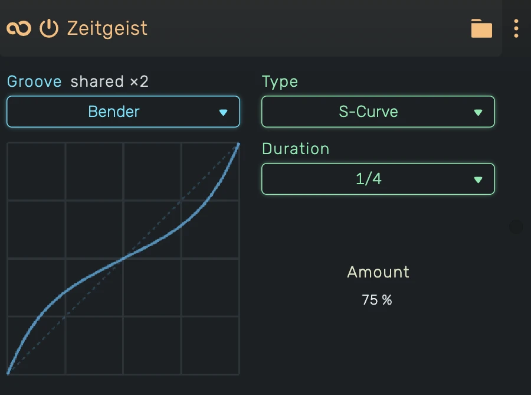

# Zeitgeist

A groove/shuffle effect that applies swing timing to MIDI notes.

---

---

## 0. Overview

_Zeitgeist_ moves the notes of an instrument in time through a [groove](/manuals/grooves). Offbeats can swing,
a phrase can speed up, notes can wobble at random or all sit a little late. The groove itself lives in the
project's groove list, so several instruments can share one and follow every change to it.

A new Zeitgeist uses the **Global Shuffle**, whose amount sits next to the tempo in the header.

Example uses:

- Adding swing to quantized drums
- Creating shuffle feel on hi-hats
- Humanizing rigid sequences
- Pushing a part slightly behind the beat

---

## 1. Groove

Picks the groove this Zeitgeist plays through.

- **Go to** opens the Grooves list and highlights the current groove
- **None** turns it off, notes pass through unchanged
- **New** creates a groove of any type and uses it
- **Make Unique** gives this Zeitgeist its own copy when the groove is shared

**shared ×** and a number next to the label tell how many users the groove has.

---

## 2. Type, Duration and Amount

The rest of the editor edits the groove itself: its **Type** (Shuffle, Power, S-Curve, Random, Offset or
Stack), its **Duration** and its **Amount**, plus the controls of the type. The same editor sits in the Grooves
list. See [Grooves](/manuals/grooves) for what each type and control does.

**Amount** at **50%** keeps time straight. Above 50% the groove takes over, below it turns the other way.

---

## 3. Technical Notes

- Warps time itself: note-ons and note-offs both move, so a note's duration stretches or shrinks with its place in the groove cell
- The automation clock of the devices after Zeitgeist is warped the same way
- Works with any MIDI source (clips, live input, other MIDI effects)
- While the transport loops, every pass plays as if it started at the loop start, see [Grooves](/manuals/grooves)
