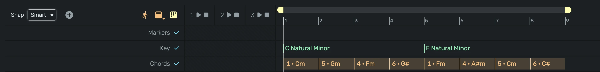

# Key & Chords

The key track and the chord track describe the harmony of your song. They make no sound themselves. MIDI
devices can follow them, so a melody stays in key and an arpeggio plays your chord progression, also after you
change the key. No music theory is needed: you pick a key and number the chords from 1 to 7.

---

## 0. Overview

- The **key** is a root note and a scale, for example C Major or A Natural Minor.
- A **chord** is a step of the key, numbered 1 to 7. In C Major step 1 is C, step 4 is F, step 5 is G and step 6
  is Am, so the well known progression C, F, G, Am is 1, 4, 5, 6.
- Chords are stored as steps, not as fixed chords. Change the key and every chord moves along.

Show the tracks from the **Primary Tracks** menu in the timeline header, or from the context menu of the key
display in the header.

---

## 1. Project Key

The key display next to Shuffle in the header shows the key at the play position, for example **C maj**.
Right click it to set the project key with **Root** and **Scale**. A new project starts in C Major. The project
key applies everywhere before the first key change, and everywhere when the key track is switched off.

Scale abbreviations: maj (Major), min (Natural Minor), hmin (Harmonic Minor), mmin (Melodic Minor), dor (Dorian),
phr (Phrygian), lyd (Lydian), mix (Mixolydian), loc (Locrian), pmaj and pmin (Pentatonic Major and Minor),
blu (Blues), whl (Whole Tone), dim (Diminished), aug (Augmented).

---

## 2. Key Track

A key change applies from its position until the next one, for example a bridge in another key.

- **Double click** an empty spot to add a key change. It starts with the key that applies there.
- **Drag** a key change to move it.
- **Right click** it to change **Root** and **Scale** or to delete it.
- The checkbox in the track header switches the key changes on and off.

Before the first key change the track shows the project key in grey.

---

## 3. Chord Track

Each chord block shows its step and the chord it plays in the key at its start, for example **5 · G**.

- **Double click** an empty spot to add a chord filling the bar.
- **Click** a chord to select it, **Shift click** adds or removes chords, **drag** over an empty spot selects all
  chords in the frame. **Ctrl A** selects all chords. The selection is saved with the project.
- **Click and hold** a chord to hear it on the instrument in edit mode. It sounds until you release it.
  While recording, it plays into the armed tracks instead, like keys on the MIDI keyboard, so the chord is recorded
  as notes, voiced and inverted as shown.
- **Keys 1 to 7** set the step of the selected chords, **Delete** removes them.
- **Drag** the selected chords to move them, drag a **right edge** to resize them. Hold **Ctrl** while
  dragging to copy them instead, for example to vary only the inversion of a copy.
- **Ctrl D** duplicates the selected chords after the last one. **Copy**, **Cut** and **Paste** work like for
  regions, pasting at the play position.
- Chords never overlap: a chord you move, copy, paste or resize shortens or deletes the chords it covers.

Right click a chord for more:

- **Degree**: the step, 1 to 7.
- **Notes**: Triad, 7th or 9th. The extra notes come from the scale, so step 1 in C Major becomes Cmaj7 and
  step 5 becomes G7.
- **Inversion**: which chord note is the lowest. The name then shows the bass note, for example **C/E**.
- **Shift**: lowers or raises the root by a semitone for chords outside the key, for example ♭7 in C Major is B♭.
- **Shape**: replaces the chord with a fixed chord type, such as Sus4 or Major 7th, on the step's root.

A chord takes the key at its start. Moving a chord into a section with another key renames it and changes its
notes. Chords need a scale with 7 notes. Under Pentatonic, Blues, Whole Tone, Diminished or Augmented the chords
are drawn grey and do not play.

---

## 4. MIDI Keyboard

The MIDI keyboard (software keyboard) has a row of chord pads 1 to 7 below the keys. Each pad shows the chord of its step
in the key at the play position and plays it on the armed instruments, in the octave of the keyboard.

- **Click and hold** a pad, or hold the keys **Z X C V B N M**, to play steps 1 to 7.
- While recording, every pad you play also writes a chord to the chord track, from the moment you press it until you
  release it, snapped to the grid. The chord track opens if it was hidden. The notes are recorded into the armed
  track as usual.
- **Scale** in the keyboard's controls maps the white keys onto the key at the play position: C plays the root,
  D the second step and so on, so every white key is in key. The black keys are silent while it is on. In scales with
  more or fewer than 7 notes the white keys walk through the steps in order.

---

## 5. Following Devices

- **[Scale Matrix](/manuals/devices/midi/scale-matrix)** with **Follow** moves every note onto the nearest key of
  the key at the note's position.
- **[Autotune](/manuals/devices/audio/autotune)** with **Follow** corrects to the key at the play position.
- The **[Cubed](/manuals/devices/instruments/cubed)** randomizer with **Project Key** draws its notes from the key.
- Scripts in **Spielwerk**, **Apparat** and **Werkstatt** read the key and chord with `this.keyAt(position)` and
  `this.chordAt(position)`.
- **[Arpeggio](/manuals/devices/midi/arpeggio)** with **Chords** plays the chord at the play position while the
  transport runs, even without holding keys. Held keys set the octave. Where no chord sits it arpeggiates the
  held keys as usual.

---

## 6. Note Editor

- The magnet button next to the scale selector makes the scale highlight follow the key at the play position.
- **Fit to Key** in the note menu moves the selected notes, or all notes, onto the nearest key of the key at their
  position. A note between two keys moves down.
