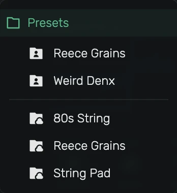
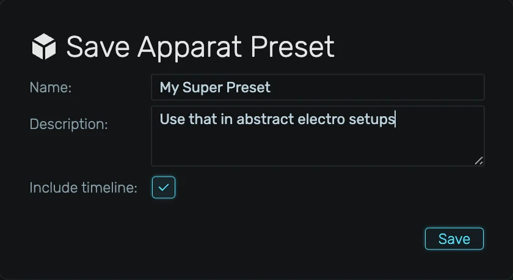
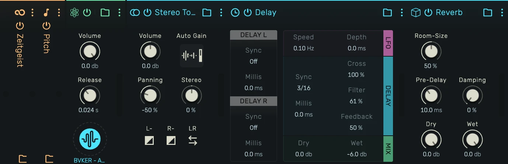

# Presets

Presets let you store and reuse devices in openDAW. A preset can be a single instrument, a single
effect, a chain of effects (a *Chain*), or a complete audio unit including its instrument, effects,
mixer settings and, optionally, its automation timeline (a *Rack*).

This manual covers how presets are saved, recalled and managed.

## Where to find them

Instrument and effect presets are listed in the [Device Browser](/manuals/device-browser), next to
the devices, community scripts and WebCLAP plugins. A click tries the preset right away, **Enter**
keeps it. The **Folder** toggle in its filter bar shows or hides presets, the **cloud folder** and
**user folder** toggles choose between stock presets and your own.

Racks and Chains are not listed in the Device Browser yet. Create them from the
[Spotlight](/manuals/spotlight) by typing their name.

### Preset dropdown on the device header

Every device header carries a folder icon next to its name. Clicking it opens a dropdown listing
every preset registered for that device, user presets at the top, and stock presets below the
separator.

Pick an entry to load it in place on the currently selected device.

## Saving a preset

Right-click a device header and open the **Preset** submenu. Entries vary by context:

- **Save '…' as Preset**, stores the instrument or the effect on its own.
- **Save Entire Audio-Unit Chain**, stores the whole audio unit as a Rack.
- **Save Audio / MIDI Effect Chain**, stores the effects of a chain as a Chain.

The *Save Preset* dialog suggests the device's current label as the name. Add a description and
tags, separated by commas, so the preset is easy to find in the Device Browser search.

### Save a single instrument

The dialog offers **Include timeline** to also store the audio unit's automation tracks, regions,
and clips together with the preset.

### Save a single effect

The dialog appears without a timeline toggle, since effect presets never carry timeline data.

### Save an effect chain (Chains)

Chains can hold a mix of different effect types, as long as they all belong to the same category
(audio or MIDI).

### Save a Rack (audio unit)

A Rack preset captures the entire audio unit: instrument, effects, mixer, send/return setup, and
optionally the timeline.

The Rack save dialog includes the **Include timeline** toggle.

### The "Include timeline" option

When enabled, the audio unit's tracks, regions, clips, and automation are encoded into the preset.
On load, openDAW recreates these timeline elements alongside the device. This lets you store
complete song-fragments (e.g. a finished drum bus, or a full lead with its melody) for re-use in
other projects.

When you keep an instrument preset with a timeline on a track that already has one, openDAW asks
whether the track's timeline should be replaced.

## Overwriting a preset

**Overwrite Preset** in the same **Preset** submenu lists your own presets that the device can replace:
presets of the same device, your Racks when you are on an audio unit, and your Chains of the matching
effect kind. Pick one to store the current state under it. Name, description and tags stay. A
confirmation is shown first, for instruments and Racks with the **Include timeline** toggle. The entry
is greyed out when nothing fits.

## Managing your presets

Select one of your presets in the Device Browser. The info card on the right offers:

- **Edit…**, change the preset's name, description and tags.
- **Duplicate**, stores a copy.
- **Delete**, removes the preset from local storage. A confirmation prompt is shown first.
- **Save to Disk…**, writes the preset to a file you can share or import again.

Stock presets are read-only and show no actions.

## Stock and user sources

- **Stock** presets are shipped with openDAW and cannot be edited or deleted. They are marked with
  the cloud-folder icon, loaded once per session, and cached.
- **User** presets live in your private OPFS storage and are included in **Cloud Backup** runs the
  same way projects and samples are.
- The first time you open the Device Browser in a session a small spinner is shown while the stock
  catalogue is fetched. Once cached, it opens instantly.