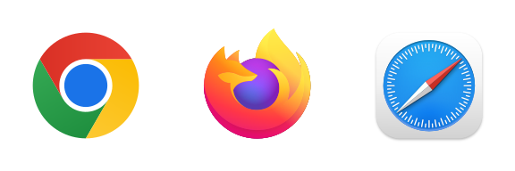
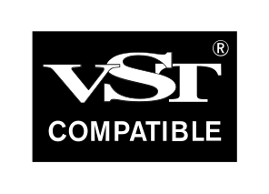

# Why openDAW Lives in the Browser
People regularly ask us for an offline version of openDAW, a desktop app and support for VST plugins. These are fair requests. This page explains why openDAW does not offer any of these today.

## We know who we are building for
Every feature pulls a product in a direction. Offline support, owning a local installation and running VST plugins are wishes of people who want openDAW to behave like a classic desktop DAW. Those DAWs already exist, and many of them are excellent. 

openDAW is something else: a studio that opens with a link, runs on any modern computer and needs no installation, no license key and no account to get started. We would rather do that one thing really well than become a weaker copy of what is already out there.
## The browser is catching up
A native desktop app would offer lower latency and direct access to your hard drive. That is attractive, but browsers improve year after year in exactly these areas. On a MacBook with an audio interface, latency in the browser is already low enough for serious work.
## Native plugins are strangers to the host
A plugin is always a guest in a DAW, and many guests keep their own house rules. Not every plugin will or can report everything the host needs through its interface. Some, for example, ship with their own undo history. There is no standard for how that should work with the host, so keeping it in sync with openDAW's own history is simply not possible. Plugins like that would undermine the reliability we want openDAW to have.

## Web plugins are the better path
WebCLAP is much closer to what we want, because it runs in the browser and needs no native host. The fundamental challenges remain the same, but the direction is right. We would rather show what a really good web DAW can do and give plugin developers a reason to release WebCLAP versions of their instruments and effects. The plugin landscape is changing quickly, and we prefer to help shape where it goes instead of chasing where it has been.

## openDAW is open source
openDAW's source code is public. Offline versions are not a priority for us just yet. We tried, and building and maintaining them is too much effort for a small team. Anybody who wants an offline version, a desktop app or VST support is free to build one within the terms of the license. We will not stand in the way, and we would be curious to see the results.
## Keeping openDAW focused
There will always be things that would be nice to have. And there are things that make a good product clunky, hard to maintain and without a clear direction. We would rather say no early than carry that weight forever. Maintaining a desktop app next to the web version would mean juggling two worlds that constantly pull against each other. We tried it. If the web platform changes enough to make any of this a natural fit for openDAW, we will happily revisit it.